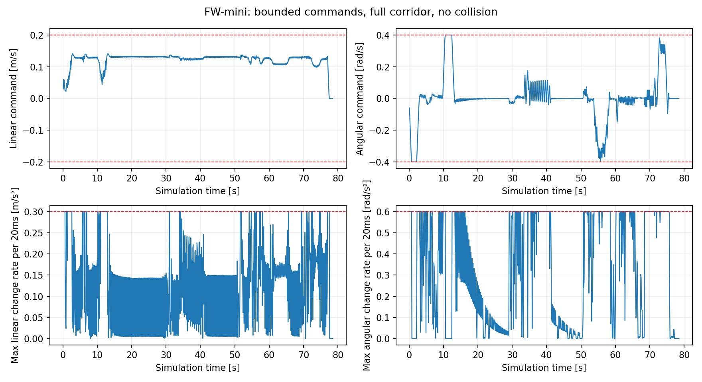

# 2026-10-22 指令变化率约束与仿真复测

已经实现真实执行链路中的限幅，并重新完成仿真。使用原 `fw_mini_balanced.yaml` 和 `fw_mini.bin`，未放宽到达门限，也未重新训练 DUNE。本次均在开发机完成；工控机及实车仍需按本文复测。

## 1. 原因与修正

旧实现只约束一次 QP 内的 `u[t+1]-u[t]`，没有约束本周期首拍与上周期指令的差，因此连续输出仍出现过约 1.501 m/s²、3.178 rad/s² 的变化。现在加入：

```text
|u_first - u_previous_applied| <= max_acce * command_dt
```

边界在同一轮 PAN 的所有迭代中保持固定。最终输出再做严格投影，消除 OSQP 求解容差引起的微小超限。正常到达和求解失败使用有界减速；移动中重设路径保留控制历史。`setAppliedCommand()` 可接执行端已下发指令反馈；这里的“执行”指软件指令，不等同于编码器测量速度。

ROS1 节点按墙钟间隔限制输出，最大间隔不超过预测步长，发布 `/neupan_emergency_stop`；交互仿真和硬件桥接均在约 50 Hz 对实际执行目标做限幅。仿真使用限幅后的速度积分车体位置，CSV 保留求解原始值、规划输出和执行值，没有事后裁剪统计数据。

| 项目 | 配置 |
| --- | --- |
| 最大纵向速度 / 角速度 | 0.20 m/s / 0.40 rad/s |
| 最大纵向 / 角加速度 | 0.30 m/s² / 0.60 rad/s² |
| 规划周期 / 执行周期 | 0.10 s / 约 0.02 s |
| 到达门限 | 0.10 m，外部终点误差验收 0.15 m |
| 几何 | 0.495 × 0.360 m，diff，vy=0 |

急停、传感器/TF 故障触发的安全停车、操作员禁用和进程退出允许立即发零，优先于正常加速度限制。桥接日志以 `stop_override` 标记，不承诺急停时仍符合舒适性减速度。驱动自身的断联超时也直接清零。本轮完整路线没有触发碰撞急停；基础/扩展测试还会检查规划输出的最大变化率，不用执行端限幅掩盖规划超限。

## 2. 复测结果

原始结果：开发机 `work/neupan_sim_results/acceleration_20261022/`，最终核心结果在 `final/`。可提交的汇总为 [JSON](docs/results/acceleration_20261022.json)、[CSV](docs/results/acceleration_20261022.csv)。

| 测试 | 结果 |
| --- | --- |
| C++ 单元/数值回归 | 4 组全部通过，包含首拍边界、PAN 多次迭代、移动中重规划、正常减速 |
| 无 ROS 执行守卫测试 | 4 项通过，覆盖使能、超时、急停/非法横向指令、单位换算 |
| 基础闭环 | 7/7，含直角、走廊、绕障、阻断道路停车 |
| 扩展闭环 | 14/14，含左右 60°/90°/120°、走廊宽度/朝向/偏置扰动 |
| 完整四障碍核心闭环 | 成功到达，无碰撞，78.5 s 仿真时间，终点误差 0.836 cm，最小车体净距 17.123 cm |
| 完整 ROS1 虚拟闭环 | 成功到达，无碰撞，目标发出至到达约 78.28 s；稳定后终点误差约 1.17 cm，最小净距 17.212 cm |
| ROS1 基本自检 | 无 scan 停车、虚拟前进、scan 中断停车通过 |
| FW-mini 桥接真实 ROS1 传输 | 默认禁用、使能后要求新指令、度/弧度换算、超时减速、急停、拒绝横移通过；使用隔离话题 |
| 底盘驱动 | 编译通过；实际驱动代码向 POSIX 管道写 CAN 帧测试通过，包含 ROS 时间冻结时的墙钟超时停车；未连接 CAN 硬件 |

基础/扩展场景最大轨迹偏差约 5.09 cm；可到达场景最大终点误差约 1.32 cm。`blocked_wall` 的目标被墙阻断，合格条件是接近后停车、保持净距、不报告到达，不能将其目标误差当成到达误差。

规划输出与执行端全套测试最大值分别不超过 **0.300000000000001 m/s²、0.600000000000004 rad/s²**，尾数来自浮点运算，验收数值容差为 `1e-8`。完整 ROS1 仿真逐执行周期记录，核心每个规划周期记录其 5 个执行子步中的最大变化率。



参数 SHA256：`9497359156d09617341a203f32428934c57dacba24efc1791ed1de7a3c64b706`。

模型 SHA256：`dd98ab315040042e52ddb8405552e7e6e681ddf2088f7793b25b2de27445f2d8`。

旧仿真使用速度保持的理想模型，本次执行端加入斜坡限制，因此运行时间变化同时包含执行模型变化；不能把前后耗时差直接解释成算法计算速度变化。ROS1 验证使用 Ubuntu 22.04 上隔离解压的 ROS1 1.15.14 / TF2 0.7.5，不替代 Ubuntu 20.04/Noetic 工控机复测。

## 3. 在工控机复现

本次修改涉及 C++ 库和节点，更新源码后必须重编译，不能只替换 YAML。带驱动工作空间的完整构建见 [硬件接入说明](FW_MINI_HARDWARE_CN.md)。不接硬件时可继续按原构建方法执行：

```bash
bash tools/build_noetic.sh all
source ~/neupan_noetic_build/activate.bash

python3 neupan_cpp_ros1/scripts/simulation_test.py --backend core --cases all \
  --config neupan_cpp_ros1/config/fw_mini_balanced.yaml \
  --output ~/neupan_sim_results/acceleration_core
python3 tools/validate_balanced_profile.py \
  --output ~/neupan_sim_results/acceleration_extended
python3 tools/validate_rviz_sim.py \
  --output ~/neupan_sim_results/acceleration_full

rosrun neupan_cpp_ros1 smoke_test.py
roslaunch neupan_cpp_ros1 sim_complete.launch auto_goal:=true
```

ROS 命令需要运行中的 ROS master。RViz 日志现在按每个执行周期写入 `trajectory.csv`，增加 `dt`、`acceleration`、`angular_acceleration`、`stop_override`；`summary.json` 保存正常执行最大变化率。`raw_v/raw_w` 是收到的规划指令，`applied_v/applied_w` 是实际用于虚拟车积分的指令。

`simulation_test.py` 的 `raw_v/raw_w` 是核心最终输出守卫前的请求值，`requested_v/requested_w` 是守卫后的规划输出，`v/w` 是执行子步结束值；`acceleration/angular_acceleration` 保存子步最大值。`max_command_*` 统计执行端，新增 `max_planner_command_*` 统计规划输出。原始请求保留用于检查求解容差。

硬件接口、CAN 字段、使能服务及实车记录方式见 [FW_MINI_HARDWARE_CN.md](FW_MINI_HARDWARE_CN.md)。实际车速、机械制动、CAN 量化、轮胎滑移及 CPU 负载尚未由本次仿真验收。
