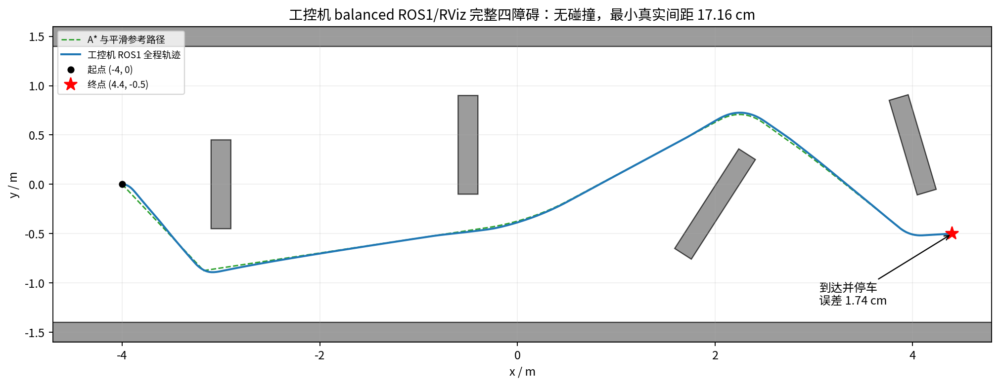

# 2026-10-21 工控机 balanced 仿真结果

审查目录为 `/home/xiapilang/work/neupan_sim_results`。以 `run.json` 的 `/home/xxz/...` 路径和配置哈希区分拷回的工控机记录与此前开发机记录，不以复制时间判断是哪次实验。原始轨迹和汇总保持不变，审查输出另存为 `ipc_balanced_analysis_20261021.csv/json`。

**最新补充结果已闭合：原 7 项与扩展 14 项共 21/21 通过；工控机完整四障碍核心仿真和实际 ROS1/RViz 默认全程均通过、无碰撞。此前缺少的退出汇总也已补齐。** 最新完整审查另存为 `ipc_balanced_complete_20261021.json`，首批审查输出保留。

## 1. 新数据使用了正确的候选

`balanced_core`、`balanced_extended`、`balanced_corridor` 及三份新 balanced RViz 运行均记录：

- balanced 配置 SHA256：`9497359156d09617341a203f32428934c57dacba24efc1791ed1de7a3c64b706`。
- FW-mini 模型 SHA256：`dd98ab315040042e52ddb8405552e7e6e681ddf2088f7793b25b2de27445f2d8`。

保存的配置快照已重新计算哈希，与记录及开发机选定配置相同。到达门限仍为 0.10 m，外部终点误差验收仍为 0.15 m，未通过放宽验收获得通过。

## 2. 原 7 场景：7/7

| 场景 | 终点误差 | 仿真时间 | 最小真实间距 | 结果 |
| --- | --- | --- | --- | --- |
| 2 m 直线 | 2.170 cm | 14.3 s | 无障碍 | 到达、停车 |
| 朝北直线 | 2.170 cm | 14.3 s | 无障碍 | 到达、停车 |
| 硬直角 | **2.713 cm** | **16.2 s** | 无障碍 | 到达、停车 |
| 4 m 稀疏路径 | 2.170 cm | 27.7 s | 无障碍 | 到达、停车 |
| 净宽 1.06 m 走廊 | **2.865 cm** | **20.9 s** | **35.000 cm** | 到达、停车 |
| 给定绕障参考路径 | 2.583 cm | 41.5 s | 50.893 cm | 到达、停车 |
| 宽墙封路 | 不要求到达 | 12.6 s | **11.013 cm** | 接近后停车，未误报到达 |

全部无碰撞。硬直角最大路径偏差为 4.959 cm，RMS 为 2.150 cm；走廊居中直行的角速度为零。此前原始参数的终点不收敛和走廊振荡，在本次候选与这组固定条件下已通过。

7 项中包含一项封路停车验收，不能把 7/7 解释为七条路线全部到达。只计有路导航为 6/6。

## 3. 扩展 14 场景：14/14

`balanced_extended` 有完整总汇总和逐项轨迹：

- 左右 60°/120°、右转 90°以及整体旋转后的左转 90°均通过；转弯误差约 2.62～2.73 cm。
- 净宽 0.86/1.06/1.26 m 的走廊，分别叠加初始朝向 ±5°，全部通过。
- 两侧墙整体偏置 ±5 cm、参考路线保持不变的两个场景通过。
- 最窄走廊的最小真实车体间距约 23.03 cm，无碰撞。

21 项的帧数、通过状态与开发机候选一致。逐帧比较的最大平面位置差约 `2.23e-8 m`、航向差约 `2.98e-6 rad`、角速度差约 `3.31e-5 rad/s`，没有出现明显轨迹偏离。

这些是不同系统上的独立理想闭环复现，尚不是新参数下的 Python/C++ 相同输入求解误差对照，也不是随机重复实验的可靠性统计。

## 4. 工控机核心规划耗时

| 场景 | 平均 | P95 | 观测最大值 |
| --- | --- | --- | --- |
| 硬直角 | 0.90 ms | 3.30 ms | 6.61 ms |
| 1.06 m 直走廊 | 12.24 ms | 22.03 ms | 24.12 ms |
| 给定绕障路径 | 4.50 ms | 8.17 ms | 9.28 ms |
| 封路停车 | 11.49 ms | 11.98 ms | 23.91 ms |

全部 21 项共 4119 次调用，观测最大值为 **25.58 ms**，没有超过 100 ms 的核心调用。扣除到达后直接返回零指令的调用后，3899 次规划的平均为 **7.47 ms**、P95 为 **21.49 ms**、P99 为 **22.66 ms**。

对已测输入，核心规划的耗时有余量适配 10 Hz 的 100 ms 周期。但这不包含点云转换、定位、TF、ROS 回调和 CAN 执行的全系统开销；当前 RViz CSV 也没有记录规划器耗时。数据未附 CPU 型号、占用率、内存和系统负载日志，不能据此给出资源利用率或轻量化加速倍数。

## 5. 完整四障碍与 ROS1/RViz 新记录

`balanced_corridor` 已包含完整核心汇总；`rviz_corridor_20261021_213935` 已包含同一默认路线的 ROS1/RViz 退出汇总。两者均从 `(-4,0)` 到 `(4.4,-0.5)`，使用与开发机一致的地图、权重和 balanced 参数。

| 指标 | 工控机核心仿真 | 工控机 ROS1/RViz 全程 |
| --- | --- | --- |
| 结果 | 到达并停车，无碰撞 | 到达并停车，无碰撞 |
| 时间 | 77.3 s 仿真时间 | 目标发出至到达约 76.75 s 墙钟 |
| 终点误差 | **1.986 cm** | **1.744 cm** |
| 最小真实车体间距 | **17.140 cm** | **17.163 cm** |
| 最终位置 | `(4.380189,-0.501347)` | `(4.382590,-0.501081)` |
| 汇总文件 | `summary.json` 完整 | `summary.json` 完整 |

核心完整地图的规划耗时平均/P95/最大为 **18.41/24.66/29.93 ms**，仍只统计核心 forward，不包含全部 ROS 与感知开销。两个闭环的时间口径不同，不据二者相除计算加速比。



另外两份 balanced RViz 运行：

- `rviz_corridor_20261021_211007` 已补齐退出汇总，共两个目标均到达，无碰撞，误差分别为 2.130/2.218 cm，最小间距约 17.165 cm。首批拷回时仅看到第一个目标与尚未关闭的日志，原先的“缺少汇总”状态已过期。
- `rviz_corridor_20261021_213926` 只记录约 2.54 s，结束时仍为 `tracking`、没有到达；这是一次未完成运行，不计通过，也不能据此判定算法失败。

默认全程已由后续 `213935` 运行完成，旧的单目标轨迹不能与它混为同一次运行。

## 6. 另外两份 RViz 是旧配置

| 目录 | 配置 | 记录结论 |
| --- | --- | --- |
| `rviz_corridor` | 旧 `fw_mini_sim.yaml` | 10 个目标中 9 个到达、1 个被后续目标替换；无碰撞，最小真实间距约 4.954 cm |
| `rviz_corridor_20261021_170835` | 旧 `fw_mini_sim.yaml` | 2 个目标均到达；无碰撞，最小间距约 16.389 cm |

两份旧运行的配置哈希均为 `34046aa01c3e1424972a2040e25b60881219a32a1ac3ee7657d117cef0724789`。目标被替换不直接计作算法失败。第二份日志累计约 14233 s，但第二个目标在启动后约 104.16 s 已到达，大部分后续日志是停车等待。

这些目标、路线不同，不能仅比较最小间距数字就量化新旧参数收益。旧 `core_fw*` 未完成记录、`ros_basic` 和 `ros_fw*` 也仍是旧配置证据，不混入新参数 21/21 的统计。

## 7. 复现与实车前剩余工作

完整四障碍结果与退出汇总已补齐。后续复测仍可使用以下入口，每次运行保存独立目录：

```bash
source ~/neupan_noetic_build/activate.bash
roslaunch neupan_cpp_ros1 sim_complete.launch auto_goal:=true
```

确认实际配置是 balanced、默认目标为 `(4.4,-0.5)`。到达后 Ctrl+C 正常退出，再复制新结果目录。核心固定地图回归可在源码根目录运行：

```bash
python3 tools/validate_rviz_sim.py \
  --output ~/neupan_sim_results/balanced_corridor
```

原始输出加速度问题仍存在：21 项最大线速度变化率约 **1.501 m/s²**、最大角速度变化率约 **3.178 rad/s²**，高于配置 0.3/0.6。当前 QP 尚无上周期执行指令到首拍的边界，本次 PASS 不含该项验收。新证据支持候选在工控机继续做闭环验证，实车前仍需处理指令连续性、真实扫描/定位与底盘接口。

## 8. 各入口实际使用的参数

当前正式规划入口与新验证工具使用同一候选，保留的基线、自检、训练各有用途：

| 入口 | 默认配置 | 说明 |
| --- | --- | --- |
| `roslaunch ... sim_complete.launch` | `fw_mini_balanced.yaml` | 仿真世界与 C++ 规划器共享同一配置，控制频率 10 Hz |
| `roslaunch ... fw_mini.launch` | `fw_mini_balanced.yaml` | 实机规划入口，仍需提供匹配的 `fw_mini.bin` |
| `tools/validate_rviz_sim.py` | `fw_mini_balanced.yaml` | 完整地图核心闭环 |
| `tools/validate_balanced_profile.py` | `fw_mini_balanced.yaml` | 14 项扩展核心闭环 |
| `scripts/simulation_test.py` | 原 `fw_mini.yaml` | 保留基线；测候选必须显式传 `--config` |
| `tools/compare_simulations.py` | 原 `fw_mini.yaml` | 基线对照工具，可传 `--config`；不会自行运行规划器 |
| 通用 `neupan_cpp_ros1.launch`、`smoke_test.py` | `smoke.yaml` + `diff_default.bin` | 演示模型自检；`fw_mini.launch` 包含通用 launch 时会覆盖这两个参数 |
| `tools/train_fw_mini.py` | `fw_mini_dune_train.yaml` | DUNE 训练配置；几何与当前候选一致，优化代价不属于训练参数 |

本轮没有同步修改独立的 ROS2 Python 工程，其默认仿真尺寸、速度与到达门限仍不同。雷达投影高度/距离、TF 外参、全局地图和底盘 CAN 接口也有独立配置，不会自动从 balanced YAML 生成。

查询当前运行节点的实际配置路径：仿真用 `rosparam get /neupan_sim/planner/config_file`，实机默认节点用 `rosparam get /neupan_node/config_file`。启动时传入 `config_file:=...` 会覆盖默认值；节点在启动时读取 YAML，修改文件后须重新启动才能生效。

## 9. 仓库内的结果摘要

- [完整工控机运行摘要](docs/results/ipc_balanced_complete_20261021.json)：原 7 项、扩展 14 项、完整核心与 ROS1/RViz 的参数标识、汇总和完成状态。
- [21 场景逐项统计](docs/results/ipc_balanced_analysis_20261021.csv)：误差、真实间距、耗时和未收敛次数。
- [各入口配置清单](docs/results/ipc_interface_inventory_20261021.json)：统一候选与保留的基线、自检、训练配置。

逐帧原始 CSV 和完整结果导出包保存在开发机结果目录，Git 仓库只纳入这些摘要和报告所需图片。
