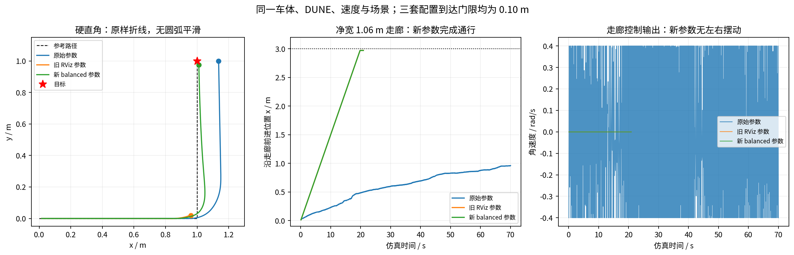

# FW-mini 直角与走廊参数调优

**2026-10-26：以下参数与结果随 diff 控制版本归档。** 它们继续用于历史软件对照，不直接复用于尚未实现的全向模型。见 [归档说明](DIFF_ARCHIVE_CN.md)。

> 2026-10-22：balanced 参数和 DUNE 模型保持不变；执行链路与 QP 首拍新增加速度约束。历史结果保留，新增结果见复测报告。 见 [变化率约束复测](ACCELERATION_VALIDATION_CN.md)。

2026-10-21，在开发机用当前 C++ 核心、实际 `fw_mini.bin` 和原有独立仿真器完成参数搜索。选出的 `config/fw_mini_balanced.yaml` 在保持 **0.10 m 到达门限**时通过原 7 场景、14 个扩展场景，以及 RViz 地图的完整四障碍走廊。

这是本次搜索范围内选择的折中候选，不是全局最优证明，也不是实车验收结果。开发机是 Ubuntu 22.04.5、Intel i7-13620H。后续工控机数据已复现 7/7 原场景和 14/14 扩展场景，完整四障碍核心及 ROS1/RViz 全程也已通过、无碰撞，后者终点误差约 1.74 cm、最小真实间距约 17.16 cm，退出汇总已齐，详见 [工控机最新结果](IPC_RESULTS_20261021_CN.md)。本页下文保留开发机调参过程与数值，工控机证据单列。

## 1. 选定参数与入口

完整文件：[fw_mini_balanced.yaml](neupan_cpp_ros1/config/fw_mini_balanced.yaml)。关键参数：

```yaml
receding: 10
step_time: 0.1
ref_speed: 0.15
collision_threshold: 0.03
ipath:
  curve_style: line
  loop: false
  arrive_threshold: 0.10
  close_threshold: 0.0
  ind_range: 30
  arrive_index_threshold: 1
pan:
  iter_num: 2
  dune_max_num: 100
  nrmp_max_num: 10
  iter_threshold: 0.1
adjust:
  q_s: [4.0, 4.0, 1.0]
  p_u: 1.0
  eta: 1.0
  d_max: 0.20
  d_min: 0.10
  ro_obs: 200.0
  bk: 0.0
```

上面是规划部分的节选，实际加载完整文件，包含同样的 diff 模型、0.495 × 0.360 m 轮廓、`wheelbase=0` 几何参考点、速度上限 `[0.2,0.4]` 和加速度参数 `[0.3,0.6]`。参考速度、速度上限、模型、车体均未改变。

`fw_mini.launch`、`sim_complete.launch` 以及 `tools/validate_rviz_sim.py` 已统一默认加载 balanced 文件。旧 `fw_mini.yaml`、`fw_mini_sim.yaml` 的内容保留，显式传入 `config_file:=...` 仍可复现旧配置。`simulation_test.py` 默认仍是原基线，评估候选时必须传 `--config`。

调这些控制参数不需要重新训练 DUNE；本次实际使用的模型 SHA256 为 `dd98ab315040042e52ddb8405552e7e6e681ddf2088f7793b25b2de27445f2d8`。候选配置 SHA256 为 `9497359156d09617341a203f32428934c57dacba24efc1791ed1de7a3c64b706`。

## 2. 搜索方法与选择依据

所有运行保留同一个 C++ 算法、激光扫描、理想 diff 虚拟底盘、参考路径和验收逻辑。未用路径平滑替换硬直角，未扩大走廊，未调大到达门限，未降低验收要求。

筛选分为：

1. **48 组直角筛选。** 预测步数取 10/15，`close_threshold` 取 0/0.03/0.06/0.10，`q_s` 取 `1`、`[2,2,1]`、`[3,3,1]`、`[4,4,1]`、`[3,3,0.5]`、`[2,2,2]`。其余首先沿用旧 RViz 的障碍参数；26 组通过硬直角。
2. **8 组组合筛选。** 选取不同步数、跟踪权重和路径搜索参数，测试直角、走廊、绕障、封路停车，8 组均为 4/4。这一步不只按直角误差排序：`close_threshold=0.03` 的部分组合精度较高，但走廊和绕障完成时间明显增加。
3. **8 组间距/代价对照。** 固定 10 步、`q_s=[4,4,1]`、最近点搜索，对照 `d_min`、`d_max`、`eta`、`ro_obs`。8 组均通过走廊、绕障和封路停车。`d_min=0.10,d_max=0.20,eta=1,ro_obs=200` 将封路真实停车间距从约 0.063 m 提高到约 0.110 m，同时保留直行和绕障表现。
4. **扩展及最终验收。** 两个候选先通过各自 14 个扩展场景。最终候选再用正式脚本串行复跑原 7 场景、14 个扩展场景及完整四障碍走廊；原始和旧 RViz 参数也串行重跑 7 场景作对照。

筛选阶段共 104 次场景执行，去重后为 55 套参数。这里不是将所有参数做全排列；间距扫描围绕一套较好的转弯组合展开。初筛部分并行运行，其耗时不用于性能比较。

选择顺序是：先满足原 7 场景和完整走廊；再看扩展通过情况、真实停车间距、预测步数、跟踪误差和完成时间。最终配置比同为 10 步的 `q_s=[3,3,1]` 候选具有更小的转角误差；相比 15 步候选减少预测规模。它没有追求以明显延长完成时间换取最低的单项终点误差。

## 3. 原 7 场景的最终结果

| 配置 | 通过比例 | 未通过项 |
| --- | --- | --- |
| 原始 `fw_mini.yaml` | 5/7，71.4% | 硬直角、直走廊 |
| 旧 RViz `fw_mini_sim.yaml` | 6/7，85.7% | 硬直角 |
| balanced 候选 | **7/7，100%** | 无 |

7 项包含一项封路停车测试；只统计其余有路导航场景时，候选为 6/6。以上每项是固定条件下单次确定性运行的场景通过比例，不是随机重复试验的成功概率。

| 场景 | 候选终点误差 | 完成/验收时间 | 最小真实间距 | 结果 |
| --- | --- | --- | --- | --- |
| `straight` | 0.02170 m | 14.3 s | 无障碍 | 通过 |
| `heading_north` | 0.02170 m | 14.3 s | 无障碍 | 通过 |
| `turn_left` | **0.02713 m** | **16.2 s** | 无障碍 | 通过 |
| `sparse_stop` | 0.02170 m | 27.7 s | 无障碍 | 通过 |
| `corridor` | **0.02865 m** | **20.9 s** | **0.35000 m** | 通过 |
| `detour` | 0.02583 m | 41.5 s | 0.50893 m | 通过 |
| `blocked_wall` | 不要求到达 | 12.6 s | **0.11013 m** | 接近后停车，未误报到达 |

硬直角的最大路径偏差由原始参数约 0.15042 m 降到 **0.04959 m**，RMS 路径偏差为 **0.02150 m**。场景依然是 `(0,0)→(1,0)→(1,1)` 的原样折线。

直走廊依然是净宽 1.06 m、两侧墙 `y=±0.53 m`。原始参数 70 s 时距目标约 2.040 m；候选 20.9 s 完成，居中直行时角速度为零，未出现原来的左右交替控制。



## 4. 扩展场景与完整地图

新增工具 [validate_balanced_profile.py](tools/validate_balanced_profile.py) 使用原脚本的控制器、扫描、积分、几何检查和验收函数，扩展 14 个场景：

- 右转 60°/90°/120°、左转 60°/120°；左转 90° 已在原 7 项中。
- 将左转 90° 路径整体旋转到朝北出发。
- 净宽 0.86/1.06/1.26 m，各叠加初始朝向 ±5°，共 6 项。
- 两侧墙整体平移 ±0.05 m，参考路线保持 y=0，形成偏离走廊中心的路线，共 2 项。这不是初始位置偏离参考路线的测试。

候选 **14/14 通过**，无碰撞。扩展转弯终点误差约 0.0262～0.0273 m；最窄的 0.86 m 走廊在初始朝向偏差下，最小真实车体间距约 **0.2303 m**。

`scenario_corridor.yaml` 的完整四障碍地图，仍使用原来的 A*、路径平滑和实际 FW-mini 权重：

| 指标 | balanced 候选 |
| --- | --- |
| 结果 | 到达并停车，无碰撞 |
| 仿真时间 | 77.3 s |
| 终点误差 | **0.019856 m** |
| 最小真实车体间距 | **0.171396 m** |
| 核心规划平均 / P95 耗时 | 16.89 / 22.01 ms |
| 本次观测的最大核心规划耗时 | 31.19 ms |

这是在开发机运行同一交互地图的 C++ 核心闭环，没有为新参数重新运行 ROS1 通信接口或 RViz 图形界面。耗时是 `planner.forward()` 范围，不包括点云处理、ROS 回调、TF 等完整系统开销，不能直接代表 i5 的实时性。

## 5. 参数为何这样组合

- **跟踪权重取中间组合。** 代码中的状态代价是 `||q_s .* (state-reference)||²`。因此旧 RViz 的位置/航向系数比为 `36/0.25=144`，候选为 `16/1=16`。候选同时提高了相对原始配置的位置跟踪权重、相对旧 RViz 配置的航向权重。测试表明它能兼顾转弯推进和终点偏差，不能仅将 `q_s` 数字视为线性代价权重。
- **保留最近点搜索。** `close_threshold=0,ind_range=30` 关闭半径内第一个点即退出的行为。它在原样硬转角和完整平滑绕障路径中都通过；部分非零阈值组合虽终点误差更小，但完成时间明显增加。
- **采用 10 步预测。** 当前速度及已测场景下，1 s 预测时长足以通过；保留 2 次 PAN 迭代、100 个 DUNE 点和 10 个 NRMP 点，没有通过削减障碍点换取结果。
- **间距参数适配走廊。** `d_min=0.10` 保留原始间距要求，`d_max=0.20`、`eta=1` 和 `ro_obs=200` 组合在已测走廊内稳定推进，并改善相对旧 RViz 参数的封路停车间距。这些是带松弛的优化参数，不保证实际间距绝不低于 `d_min`。

上述解释结合代价形式和实验观察。多参数存在耦合，当前搜索不构成对停滞根因的唯一归因。

## 6. 工控机复现与 RViz 使用

先将 `neupan_balanced_update.tar.gz` 复制到工控机 `~/work/`，在已有 ROS1 仿真代码根目录解压：

```bash
cd ~/work/neupan_noetic_bundle/neupan_cpp
tar -xzf ~/work/neupan_balanced_update.tar.gz -C .
source ~/neupan_noetic_build/activate.bash

# 原 7 场景；显式指定当前候选
python3 neupan_cpp_ros1/scripts/simulation_test.py \
  --backend core --cases all \
  --config neupan_cpp_ros1/config/fw_mini_balanced.yaml \
  --output ~/neupan_sim_results/balanced_core

# 14 个扩展场景
python3 tools/validate_balanced_profile.py \
  --output ~/neupan_sim_results/balanced_extended

# 与 RViz 相同地图的完整核心闭环
python3 tools/validate_rviz_sim.py \
  --output ~/neupan_sim_results/balanced_corridor

# 点选终点，默认已经加载 balanced 候选
roslaunch neupan_cpp_ros1 sim_complete.launch
```

上述三个 Python 工具的 `--binary` 默认是 `~/neupan_noetic_build/libneupan/neupan_sim_backend`；模型默认来自当前源码包的 `models/fw_mini.bin`。输出目录重名会自动另建目录。

更新不包含权重，也不改 C++ 算法，无需重训 DUNE。本机若使用 catkin install 空间而非源码工作空间，需要重新构建/安装使新增配置和 launch 生效。可先 `rospack find neupan_cpp_ros1` 确认 ROS 找到的是更新后的包，再通过 `rosparam get /neupan_sim/planner/config_file` 核对启动时实际加载的文件。

实机规划入口同样默认加载该配置，仍要求你显式提供实际匹配的模型：

```bash
roslaunch neupan_cpp_ros1 fw_mini.launch \
  dune_checkpoint:="$(rospack find neupan_cpp_ros1)/models/fw_mini.bin"
```

该入口发布规划输出，不包含本次未完成的 CAN 桥接与实车验收。

## 7. 原始证据与边界

开发机完整目录：`/home/xiapilang/work/neupan_sim_results/parameter_tuning_20261021/`。

| 文件或目录 | 内容 |
| --- | --- |
| `experiment.json`、`selection_policy.json`、`invariants.json` | 固定条件、选择顺序、源码/模型/参数哈希 |
| `search.py`、`screen_combined.py`、`screen_margins.py` | 本次实际执行的搜索脚本 |
| `screening/` | 全部筛选配置、逐帧轨迹和结果 |
| `final_baseline/`、`final_previous_rviz/`、`final_balanced/` | 串行最终 7 场景对照 |
| `final_extended/` | 正式扩展工具的 14 项结果及场景定义 |
| `final_rviz_balanced/` | 完整四障碍轨迹、参考路径与汇总 |
| `comparison.csv/json` | 原始、旧 RViz、候选各 7 项的合并对照 |

原仿真验收仍要求终点误差 ≤0.15 m、最大路径偏差 ≤0.35 m、RMS ≤0.15 m、超调 ≤0.15 m、有障碍场景真实间距 ≥0.03 m，且到达后低速停车至少 1 s。封路要求接近后停车至少 2 s、不误报到达。候选各导航场景实际终点误差均小于 0.03 m。

**未解决的实际指令加速度问题仍然保留。** 原 7 项中候选最大输出变化率约为线速度 1.501 m/s²、角速度 2.624 rad/s²，超过配置的 0.3/0.6。当前 QP 约束预测控制序列内部相邻项，没有把上周期执行控制作为首拍约束；本次只调 YAML，未改这段算法。场景通过不包含该项验收。

实机前还需验证原始输出到执行指令的连续性、真实定位与扫描、底盘动力学及独立超时停车。未测试噪声、延迟、动态障碍、任意转角或全向横移；本次结果不能代替这些验证，也不能作为 Python/C++ 轻量化加速比。
