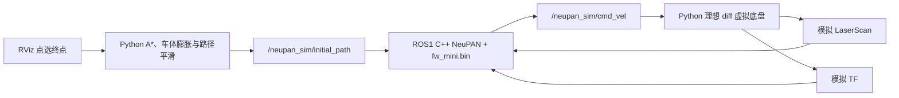

# NeuPAN C++ / ROS1：FW-mini 导航与闭环仿真

面向 **Ubuntu 20.04、ROS Noetic、FW-mini 底盘和 Intel i5 工控机**的 NeuPAN C++ 初步移植与验证模块，用于 [mvp-inspection-robot](https://github.com/sustc-xia-explorer/mvp-inspection-robot) 项目的局部规划、模型部署和轻量化实验。

目前已完成独立 C++ 核心的 Eigen 3.3 兼容、ROS1 接口、FW-mini DUNE 训练/导出辅助工具、数值回归、虚拟闭环以及可在 RViz 点选终点的走廊绕障仿真。当前运动模型为 **diff，控制量为纵向速度 vx 与角速度 wz**；全向横移和实车完整闭环尚未完成。

本文以本目录的实际代码和验证记录为准。遗留 ROS2 源文件和旧启动文件是上游参考材料，不代表当前 ROS1 的安装入口或完成状态。


## 1. 项目边界与当前能力

本仓库直接在根目录保存 `libneupan/`、`neupan_cpp_ros1/` 和 `tools/`，不再额外嵌套 `neupan_cpp/`。从 GitHub 检出后，在仓库根目录执行本文命令。

本轮新增或修改的 NeuPAN 核心、ROS1 节点、配置、仿真、训练辅助脚本和文档，均在本目录内。开发机上的工作副本位于 `work/mvp_ws/src/neupan_cpp`；本文后续命令均从 **包含本 README 的源码根目录**执行。

| 内容 | 位置或状态 |
| --- | --- |
| NeuPAN C++ 算法核心 | `libneupan/`，不依赖 ROS |
| ROS1 节点与交互仿真 | `neupan_cpp_ros1/` |
| 构建、训练、模型检查和对照工具 | `tools/` |
| Python NeuPAN 训练框架 | 外部依赖；开发机现有 `~/NeuPAN`，不包含在本模块中 |
| OSQP、osqp-eigen、QDLDL 源码 | 外部依赖；Git 源码目录不自带，离线部署包另行提供 |
| Livox 驱动与 FAST-LIO2 | 外部工作空间；当前开发机在 `work/ws_livox` |
| FW-mini CAN 驱动 | 相邻的 `work/mvp_ws/src/FW-mini-ros`，不包含在本模块中 |
| 实验原始数据与部署压缩包 | 开发机 `work/neupan_sim_results`、`work/*.tar.gz`，位于本源码目录之外 |
| 构建和安装产物 | 由脚本生成到用户目录，不属于应提交的源码 |

FW-mini 遥控模式二已观察到前进、后退和原地旋转，模式三可横移。当前 diff 方案仍需确认底盘 CAN 模式能连续执行组合 vx/wz；遥控模式编号不能直接当作 CAN gear 值。Python 上游支持其他运动模型，不代表本 C++ 版本已经支持全向运动。

## 2. 算法和仿真架构

### 2.1 C++ 部署链路

```text
开发电脑：Python NeuPAN / PyTorch 训练
  → model_5000.pth
  → export_dune_weights.py
  → 含 footprint 元数据的 fw_mini.bin

工控机：libneupan
  ├─ Eigen MLP：加载权重并执行 DUNE 前向推理
  ├─ NRMP：构造 QP，通过 OsqpEigen / OSQP 求解
  ├─ PAN：交替迭代 DUNE 与 NRMP
  └─ NeuPANPlanner：参考轨迹、预测轨迹与首拍控制输出
       → ROS1 neupan_node → geometry_msgs/Twist
```

部署阶段的 DUNE/PAN/NRMP 在 C++ 中运行，不调用 Python NeuPAN、PyTorch、cvxpy 或 LibTorch。Python 仍用于训练、部分验证工具和虚拟环境。当前控制输出直接来自 NeuPAN，不额外经过 Pure Pursuit。

### 2.2 RViz 仿真闭环



全局 A* 是 `scripts/rviz_sim.py` 中新增的 Python 实现，独立于 NeuPAN 核心。原仓库 `src/astar_global_node.cpp` 仍是 ROS2 参考代码，没有被编译为 ROS1 全局规划节点。

A* 负责静态地图上的全局可通行路径，NeuPAN 根据扫描做局部优化和避障。当前仿真验证这一组合，不等同于 NeuPAN 单独完成全局寻路，也不是全流程纯 C++ 仿真。

## 3. 源码目录

```text
mvp-inspection-robot/
├── README.md                         # 当前项目入口
├── LICENSE                           # 本模块沿用的 GPLv3 许可证文本
├── COMMIT_MESSAGE.txt                # 初步版本的提交说明
├── libneupan/
│   ├── include/neupan/               # C++ 核心接口
│   ├── src/                          # MLP、DUNE、NRMP、PAN、路径及运动模型
│   ├── models/                       # 上游演示模型
│   ├── tests/                        # 核心回归及固定回放数据
│   └── tools/
│       ├── export_dune_weights.py    # .pth → .bin，写入几何元数据
│       ├── sim_backend.cpp           # 无 ROS 的 C++ 仿真/MLP 检查后端
│       └── bench.cpp                 # 上游核心基准工具
├── neupan_cpp_ros1/
│   ├── src/neupan_node.cpp           # 当前编译的 roscpp 规划节点
│   ├── scripts/
│   │   ├── smoke_test.py             # 首次扫描前停车、跟踪、扫描丢失停车
│   │   ├── simulation_test.py        # core / ros / python 七场景回归
│   │   └── rviz_sim.py               # 地图、A*、扫描、虚拟底盘与日志
│   ├── launch/
│   │   ├── sim_complete.launch       # RViz 交互仿真入口
│   │   ├── fw_mini.launch            # 外部 TF/scan 下的 FW-mini 规划节点
│   │   ├── neupan_cpp_ros1.launch    # 通用接口；默认使用演示几何
│   │   └── livox_scan.launch         # PointCloud2 → LaserScan
│   ├── config/
│   │   ├── fw_mini.yaml              # 原 FW-mini 回归基线
│   │   ├── fw_mini_sim.yaml          # 交互仿真控制参数
│   │   ├── fw_mini_dune_train.yaml   # DUNE 训练配置
│   │   ├── smoke.yaml               # 原默认模型的软件接口自检
│   │   ├── scenario_corridor.yaml
│   │   ├── scenario_corridor_original.yaml
│   │   └── maps/                     # 加宽走廊与原 ROS2 地图
│   ├── models/                      # FW-mini 与接口自检所用 .bin
│   ├── rviz/fw_mini_sim.rviz
│   └── test/                        # 新增几何测试及遗留 ROS2 参考脚本
├── tools/
│   ├── build_noetic.sh               # 构建依赖、核心及 ROS1 接口
│   ├── train_fw_mini.py
│   ├── check_dune_export.py
│   ├── validate_rviz_sim.py
│   ├── compare_simulations.py
│   └── model/                       # 本地训练输出；可重新生成
└── *_CN.md                           # 安装、验证、RViz 与工控机分析文档
```

目录里保留的 `.launch.py`、`*_ros2.*`、`*copy*` 备份及原 ROS2 测试不属于当前 ROS1 运行入口。以 `CMakeLists.txt` 中实际构建/安装的目标为准。

## 4. 环境与依赖

| 项目 | 当前要求或验证条件 |
| --- | --- |
| 工控机 | Intel x86_64 / i5，Ubuntu 20.04，ROS Noetic |
| C++ | C++17；已处理 GCC 9 / Eigen 3.3 兼容问题 |
| CMake | 3.18 及以上的 3.x；构建脚本不接受 CMake 4.x |
| Eigen | 3.3 及以上，保留 Ubuntu 20.04 系统版本即可 |
| 其他核心依赖 | yaml-cpp、OSQP 1.x、osqp-eigen、GTest |
| Python | 3.8 及以上；仿真用 PyYAML，绘图用 matplotlib |
| RViz | ROS1 `rviz` |
| 训练/导出/原版对照 | 独立的 Python NeuPAN 环境及其 PyTorch/cvxpy 依赖 |

本次使用的依赖提交如下，避免直接跟随最新分支造成 API 变化：

| 依赖 | 固定提交 | 版本标识 |
| --- | --- | --- |
| 上游 neupan_cpp 基础代码 | `7408e4e1505ec3daa50da38ee8627f4eb9be895a` | 叠加本模块修改 |
| OSQP | `1572ae068e9ce9ca723cf8223548ade1ff7acc29` | v1.0.0-22-g1572ae06 |
| osqp-eigen | `7587e6994dc194cf22511d909bf4cc5d5e0e4eb2` | v0.11.2 |
| QDLDL | `138fdac58b9cd1c4137ff1b99152c8108a6cff5b` | v0.1.8 |

先准备好 Ubuntu 20.04 / ROS Noetic，再执行：

```bash
source /opt/ros/noetic/setup.bash
rosversion -d

sudo apt update
sudo apt install -y build-essential cmake git curl ca-certificates rsync \
  libeigen3-dev libyaml-cpp-dev libgtest-dev python3-rospkg \
  python3-yaml python3-matplotlib \
  ros-noetic-catkin ros-noetic-roscpp ros-noetic-rospy ros-noetic-roslib \
  ros-noetic-sensor-msgs ros-noetic-nav-msgs ros-noetic-geometry-msgs \
  ros-noetic-visualization-msgs ros-noetic-std-msgs ros-noetic-diagnostic-msgs \
  ros-noetic-tf ros-noetic-tf2 ros-noetic-tf2-ros ros-noetic-rviz \
  ros-noetic-pointcloud-to-laserscan
```

`rosversion -d` 应输出 `noetic`。构建时使用只加载 Noetic 的终端。

Ubuntu 20.04 系统 CMake 3.16.3 不满足本构建流程，可以单独准备 3.22.6：

```bash
mkdir -p ~/.local/opt
curl -L --fail \
  https://github.com/Kitware/CMake/releases/download/v3.22.6/cmake-3.22.6-linux-x86_64.tar.gz \
  -o /tmp/cmake-3.22.6-linux-x86_64.tar.gz
tar -xzf /tmp/cmake-3.22.6-linux-x86_64.tar.gz -C ~/.local/opt
export NEUPAN_CMAKE="$HOME/.local/opt/cmake-3.22.6-linux-x86_64/bin/cmake"
"$NEUPAN_CMAKE" --version
```

若已有满足要求的 CMake 3.x，可直接使用。上述下载面向 x86_64；新终端需要重新设置 `NEUPAN_CMAKE`。

## 5. 从源码构建

### 5.1 准备依赖源码

Git 检出的本模块不自动包含 OSQP 等依赖。首次部署可准备独立目录；以下 clone 命令用于尚不存在这些目录的情况：

```bash
mkdir -p ~/work/neupan_deps
git clone https://github.com/osqp/osqp.git ~/work/neupan_deps/osqp
git -C ~/work/neupan_deps/osqp checkout 1572ae068e9ce9ca723cf8223548ade1ff7acc29

git clone https://github.com/gbionics/osqp-eigen.git ~/work/neupan_deps/osqp-eigen
git -C ~/work/neupan_deps/osqp-eigen checkout 7587e6994dc194cf22511d909bf4cc5d5e0e4eb2

git clone https://github.com/osqp/qdldl.git ~/work/neupan_deps/qdldl
git -C ~/work/neupan_deps/qdldl checkout 138fdac58b9cd1c4137ff1b99152c8108a6cff5b

export NEUPAN_DEPS_SOURCE_ROOT="$HOME/work/neupan_deps"
```

若使用另行提供的 `neupan_noetic_bundle.tar.gz`，其中已有 `neupan_cpp/` 和同级 `deps/`。在该包的 `neupan_cpp/` 下构建时，脚本会自动使用同级 `deps/`。普通源码布局未指定依赖目录时，默认检查 `$HOME/work`。

### 5.2 构建核心与 ROS1 接口

进入本 README 所在目录：

```bash
bash tools/build_noetic.sh all
```

执行顺序为 OSQP → osqp-eigen → libneupan → 核心测试 → 安装核心 → catkin 构建 ROS1 接口。成功后出现 `ROS1 build completed`：

```bash
source ~/neupan_noetic_build/activate.bash
rospack find neupan_cpp_ros1
```

只构建无 ROS 核心可使用 `bash tools/build_noetic.sh core`；该模式不生成 ROS1 的 `activate.bash`。

| 变量 | 默认值或作用 |
| --- | --- |
| `NEUPAN_CMAKE` | `cmake`，可指定独立 CMake 的绝对路径 |
| `NEUPAN_DEPS_SOURCE_ROOT` | 优先同级 `deps/`，否则 `$HOME/work` |
| `NEUPAN_BUILD_ROOT` | `$HOME/neupan_noetic_build` |
| `NEUPAN_INSTALL_PREFIX` | `$HOME/.local/neupan-noetic` |
| `NEUPAN_ROS_WS` | `$HOME/neupan_noetic_ws` |
| `NEUPAN_JOBS` | 2 |
| `NEUPAN_EIGEN3_DIR` | 可选的 Eigen CMake 配置目录 |

脚本将 `neupan_cpp_ros1` 链接到独立 catkin 工作空间。它不把依赖安装到 `/usr/local`，也不修改 FAST-LIO/PCL。移动源码或切换另一份副本时，应使用新的构建目录和 ROS 工作空间，避免旧缓存/链接指向另一份代码。

## 6. 运行 RViz 交互仿真

### 6.1 启动与操作

确认 `neupan_cpp_ros1/models/fw_mini.bin` 存在。当前工作副本已提供该权重，提交代码时应保留；缺失时按第 8 节训练和导出。

```bash
source ~/neupan_noetic_build/activate.bash
roslaunch neupan_cpp_ros1 sim_complete.launch \
  sim_env_config:=scenario_corridor.yaml
```

launch 启动 Python 世界节点、实际 ROS1 C++ `neupan_node` 和 RViz。无 master 时 roslaunch 会启动 master；已有 master 时复用。仿真按墙钟运行，要求该 master 的 `/use_sim_time=false`。

在 RViz 中：

1. 初始位置为 `(-4, 0)`，朝向为 0，机器人等待目标。
2. 使用 **2D Nav Goal** 设置终点，先试 `(-1.6, 0)` 绕过第一处障碍。
3. 再试 `(4.4, -0.5)` 完成四处障碍的完整走廊。
4. 使用 **2D Pose Estimate** 重设起点和朝向；重设后等待新目标。

绿线为全局参考路径，橙线为 NeuPAN 预测轨迹，蓝线为实际轨迹，红色点为模拟扫描。目标箭头当前用于输入目标位置，不保证最终航向精确匹配拖动角度。

自动运行默认终点或关闭图形界面：

```bash
roslaunch neupan_cpp_ros1 sim_complete.launch auto_goal:=true

# 无 RViz 图形窗口，仍运行完整 ROS1 闭环
roslaunch neupan_cpp_ros1 sim_complete.launch \
  use_rviz:=false auto_goal:=true
```

其他参数包括 `config_file`、`dune_checkpoint`、`scenario_file` 和 `output`。例如使用其他位置的权重，可追加 `dune_checkpoint:=/绝对路径/fw_mini.bin`。

### 6.2 场景与结果

| 场景 | 几何与用途 |
| --- | --- |
| `scenario_corridor.yaml` | 保留原四处内障碍，走廊墙位于 y=±1.5 m，墙内净宽 2.8 m，适配 FW-mini 调试 |
| `scenario_corridor_original.yaml` | 保留此前 ROS2 地图，墙位于 y=±1 m，墙内净宽 1.8 m，用于对照 |

原图第一处障碍两侧各约 0.45 m 间隙。A* 使用 FW-mini 外接圆、额外间距与网格覆盖范围，完整穿越原图会判为无路；这是当前全局规划器的保守判定，不能据此推断所有底盘姿态都不可通过。

仿真只发布 `/neupan_sim/` 下的控制和输入话题，TF 使用 `neupan_sim/` 前缀。默认结果目录为 `~/neupan_sim_results/rviz_corridor`，重名自动追加时间戳。记录包括：

- `trajectory.csv`：位姿、原始/执行指令、真实车体间距、到达和碰撞状态。
- `run.json`：配置和模型哈希、命令话题及输出路径。
- `planner.yaml`、`scenario.yaml`、`map.yaml`：运行快照。
- `goal_XXX_path.json`：每次接受的全局路径。
- `summary.json`：正常退出时的汇总与各目标状态。

独立几何检查发现接触障碍时，车体变红、记录碰撞并冻结，需重设起点恢复。该冻结不是 NeuPAN 成功避障。虚拟底盘是理想 diff 运动学，不模拟 CAN、轮组切换、打滑、Mid-360S 三维扫描或真实动力学。

## 7. 机器人与间距参数

FW-mini 初始矩形轮廓为长 0.495 m、宽 0.360 m，参考速度 0.15 m/s，最大速度 `[0.2 m/s, 0.4 rad/s]`。尺寸需包含实际突出设备；当前 `base_link` 约定在轮廓中心。

这里 `wheelbase: 0.0` 参与轮廓参考点定义，不是底盘物理轴距参数，不能直接填入手册中的物理轴距。

| 参数 | 回归基线 `fw_mini.yaml` | 交互仿真 `fw_mini_sim.yaml` |
| --- | --- | --- |
| 预测步数 / 步长 | 10 / 0.1 s | 15 / 0.1 s |
| `q_s` | 1.0 | `[6, 6, 0.5]` |
| `close_threshold` | 0.10 m | 0；在前向范围搜索最近点 |
| `eta` | 15 | 1 |
| `d_min` / `d_max` | 0.10 / 0.50 m | 0.05 / 0.15 m |
| `ro_obs` | 10 | 200 |
| `collision_threshold` | 0.03 m | 0.03 m |
| 到达距离门限 | 0.10 m | 0.10 m |

这些是不同实验配置。新配置和路径平滑的收益不能归为单纯的 C++ 移植收益。当前两个 ROS1 规划入口的控制频率均为 10 Hz；修改 `step_time` 时须同步检查控制频率。

交互仿真中相关距离的含义：

| 判定或参数 | 当前值 | 含义 |
| --- | --- | --- |
| `collision_threshold` | 0.03 m | DUNE 估计的当前车体轮廓到最近障碍点距离低于此值时，规划器强制零速度 |
| `adjust.d_min` | 0.05 m | 优化中的间距要求，存在松弛项，并非绝对硬保证 |
| `adjust.d_max` | 0.15 m | 优化间距变量上限，不是停车距离 |
| 场景 `safety_margin` | 0.04 m | A* 外接圆之外的额外余量，另有网格覆盖范围 |
| 真实碰撞 | 间距 ≤ 0 m | 仿真独立计算的矩形车体碰撞判定 |

RViz 状态的 `clearance` 是独立真实几何间距，规划器停车使用 DUNE 估计，两者可能不同。到达、TF/扫描过期、求解失败、命令超时和路径阻塞也可能导致在较远位置停车。

## 8. DUNE 训练导出与一致性检查

训练在开发电脑的 Python NeuPAN 环境执行。先按 [Python NeuPAN 上游](https://github.com/hanruihua/NeuPAN) 配置环境，确保 `from neupan import neupan` 可正常导入。本模块不自动安装训练框架。

### 8.1 训练与导出

在同一个 Python 环境、当前源码根目录执行：

```bash
python tools/train_fw_mini.py

python libneupan/tools/export_dune_weights.py \
  tools/model/fw_mini/model_5000.pth \
  neupan_cpp_ros1/models/fw_mini.bin 0.495 0.360 0.0
```

训练参数位于 `neupan_cpp_ros1/config/fw_mini_dune_train.yaml`，当前为 100000 个样本、5000 epoch、batch 256。输出到 `tools/model/`，重复训练可能生成带后缀的新目录，以终端打印的实际 checkpoint 为准。

修改尺寸时，应同步训练配置、实际使用的规划配置和导出命令。训练几何、导出元数据与规划轮廓必须一致；只改元数据不能代替训练。把 `.bin` 复制到工控机用于部署，`.pth` 留作训练记录和对照。

当前 FW-mini `.bin` 的 SHA256：

```text
dd98ab315040042e52ddb8405552e7e6e681ddf2088f7793b25b2de27445f2d8
```

这是当前权重的标识，不是所有重新训练结果必须相同的值。`diff_default.bin` 用于原演示几何的软件自检，不能替代 FW-mini 模型。

### 8.2 对照 Python 与 Eigen MLP

开发机先构建 C++ 核心，再在 Python NeuPAN 环境运行：

```bash
python tools/check_dune_export.py \
  --binary ~/neupan_noetic_build/libneupan/neupan_sim_backend \
  --config neupan_cpp_ros1/config/fw_mini.yaml \
  --model neupan_cpp_ros1/models/fw_mini.bin \
  --checkpoint tools/model/fw_mini/model_5000.pth \
  --output ~/neupan_sim_results/fw_dune_export.json
```

工具用 1000 个相同 float32 输入点比较网络输出，默认最大绝对误差门限为 1e-4。它验证权重导出和网络前向实现，不验证学到的几何距离在所有位置都准确。

## 9. 分层测试与结果输出

### 9.1 核心数值与独立几何检查

```bash
ctest --test-dir ~/neupan_noetic_build/libneupan --output-on-failure
python3 -m unittest discover -s neupan_cpp_ros1/test -p 'test_*.py'
```

核心包含 `test_dune`、`test_nrmp`、`test_replay`。回放使用上游演示模型和固定数据，并同步 Python nominal 控制序列，不是 FW-mini 实车验收。

回放保留所有数值断言并报告耗时，默认不使用原开发机写死的 5 ms 门限。显式执行性能预算：

```bash
NEUPAN_REPLAY_MAX_MEAN_MS=5 ctest \
  --test-dir ~/neupan_noetic_build/libneupan -R '^test_replay$' -V
```

预算必须为有限正数，超出预算仍会失败。未设置预算的回归通过，不表示通过了 5 ms 实时性验收。

### 9.2 ROS1 基本自检

一个终端启动 master，另一个终端执行自检：

```bash
# 终端 A
source ~/neupan_noetic_build/activate.bash
roscore
```

```bash
# 终端 B
source ~/neupan_noetic_build/activate.bash
rosrun neupan_cpp_ros1 smoke_test.py
```

自检使用独立命名空间和演示模型，检查首次扫描前零速度、虚拟车前进、扫描丢失后停车。该 PASS 不代表 FW-mini 障碍避让已通过。

### 9.3 七场景回归

场景包括 `straight`、`heading_north`、`turn_left`、`sparse_stop`、`corridor`、`detour`、`blocked_wall`。其中 detour 跟踪已绕障的参考路径，blocked_wall 预期靠近后停车，不以穿墙到达为成功。

```bash
# 无 ROS 核心闭环，按数学时间快速推进
python3 neupan_cpp_ros1/scripts/simulation_test.py \
  --backend core --cases all --output ~/neupan_sim_results/core_fw

# ROS1 完整接口闭环，需要已有 roscore
source ~/neupan_noetic_build/activate.bash
rosrun neupan_cpp_ros1 simulation_test.py \
  --cases all --output ~/neupan_sim_results/ros_fw

# 使用交互仿真参数做回归；原基线保留
python3 neupan_cpp_ros1/scripts/simulation_test.py \
  --backend core --cases all \
  --config neupan_cpp_ros1/config/fw_mini_sim.yaml \
  --output ~/neupan_sim_results/core_visual_profile
```

默认使用 `fw_mini.yaml` 和 `fw_mini.bin`，可通过 `--config`、`--model`、`--binary` 覆盖。脚本打印实际输出目录，重名时自动追加时间戳，并逐行保存轨迹和打印进度。`--cases all` 遇到未通过项会返回非零退出码，这是实验结果，需要查看失败原因。

Python 对照需切换到 Python NeuPAN 环境，并保持同配置、同训练权重：

```bash
python neupan_cpp_ros1/scripts/simulation_test.py \
  --backend python --cases all \
  --checkpoint tools/model/fw_mini/model_5000.pth \
  --output ~/neupan_sim_results/python_fw

python tools/compare_simulations.py \
  ~/neupan_sim_results/core_fw ~/neupan_sim_results/python_fw \
  --output ~/neupan_sim_results/comparison_fw
```

将对照输入替换为本次实际打印的输出目录；对照工具自己的输出目录须尚不存在。它比较独立闭环轨迹，小的动作差会经反馈累积，不能直接视为相同输入下的求解误差。

各回归运行保存配置/模型标识、总 `summary.csv/json`，每场景保存 `trajectory.csv`、`summary.json`、`backend.log` 和可选轨迹图。无 matplotlib 时仍可输出数值结果。

交互地图的纯核心验证入口：

```bash
python3 tools/validate_rviz_sim.py \
  --binary ~/neupan_noetic_build/libneupan/neupan_sim_backend \
  --output ~/neupan_sim_results/rviz_core_check
```

## 10. ROS1 接口与真实传感器接入

### 10.1 规划节点接口

以下为独立 `neupan_node` 的默认话题，交互仿真会 remap 到 `/neupan_sim/`：

| 方向 | 话题 | 类型或用途 |
| --- | --- | --- |
| 输入 | `/scan` | `sensor_msgs/LaserScan`，二维障碍观测 |
| 输入 | `/initial_path` | `nav_msgs/Path`，至少两个点 |
| 输入 | `/neupan_goal` | `geometry_msgs/PoseStamped`，生成直线参考，不自动全局绕障 |
| 输入 | `/neupan_waypoints` | `nav_msgs/Path`，路径点输入 |
| 输入 | TF `map_frame → base_frame` | 当前 x/y/yaw，不直接以 odom 消息作为机器人状态 |
| 输入 | TF `map_frame → scan.header.frame_id` | 扫描按消息时间和实际 frame 变换 |
| 输出 | `/neupan_cmd_vel` | `geometry_msgs/Twist`，使用 linear.x / angular.z |
| 输出 | `/neupan_plan`、`/neupan_ref_state`、`/neupan_initial_path` | 优化轨迹、参考状态与完整参考路径 |
| 输出 | `/neupan_arrive` | `std_msgs/Bool` |
| 输出 | `/neupan_diagnostics` | `diagnostic_msgs/DiagnosticArray` |
| 输出 | `/dune_point_markers`、`/nrmp_point_markers`、`/robot_marker` | RViz 标记 |

节点要求 `config_file` 和 `.bin` 格式的 `dune_checkpoint` 参数。默认控制频率 10 Hz，扫描/TF 超时为 0.5 s，求解失败宽限为 0。首次有效扫描之前、扫描过期、位姿 TF 过期或求解失败时发布零速度。路径/目标必须使用与 `map_frame` 相同的 frame。

### 10.2 Mid-360S 与 FAST-LIO2

先在外部工作空间验证 Livox 驱动与 FAST-LIO2，再提供 TF 和二维观测。本模块已有转换入口：

```bash
source ~/neupan_noetic_build/activate.bash
roslaunch neupan_cpp_ros1 livox_scan.launch \
  cloud_topic:=/cloud_registered_body target_frame:=base_link
```

它将 PointCloud2 变换到目标系后按高度筛选、投影为 LaserScan；不会创建二维占据地图，也不会完成底盘外参标定。高度默认 0.10～1.00 m，距离默认 0.5～5.0 m，需按实测坐标和障碍物调整；车体回波裁剪和通用地面分割未实现。

FAST-LIO 的 `camera_init → body` 中，body 是雷达内置 IMU 坐标系，不是底盘几何中心。倾斜安装雷达时，要补充实测 `body → base_link` 刚性变换，并确认投影平面、地面方向和规划世界系。FAST-LIO 的雷达/IMU 内参外参不能代替雷达到底盘的安装外参。

已有 TF/scan/全局参考路径后，可启动规划节点：

```bash
roslaunch neupan_cpp_ros1 fw_mini.launch \
  dune_checkpoint:="$(rospack find neupan_cpp_ros1)/models/fw_mini.bin" \
  map_frame:=map base_frame:=base_link scan_topic:=/scan
```

这里 `map` 必须已经存在于实际 TF 树中。仅有 FAST-LIO 的 camera_init/body 时，不会自动产生 map；可在确认平面方向后选择对应世界系，或先建立所需变换。完整标定说明见 [NOETIC_SETUP_CN.md](NOETIC_SETUP_CN.md)。

### 10.3 FW-mini 底盘接口

现有驱动接收 `/ctrl_cmd`、`yhs_can_msgs/ctrl_cmd`，与 Twist 类型不同，不能用话题 remap 代替转换。

| NeuPAN 输出 | 底盘字段 | 当前接入要求 |
| --- | --- | --- |
| `linear.x` | `ctrl_cmd_x_linear` | 确认 m/s 和正负方向 |
| `linear.y` | `ctrl_cmd_y_linear` | 当前阶段固定为 0 |
| `angular.z` | `ctrl_cmd_z_angular` | 当前驱动约定 °/s，输入 rad/s 需乘 180/π |
| 控制模式 | `ctrl_cmd_gear` | 以实际固件协议和 CAN 验证为准 |

Twist 到 CAN 消息的实车转换、gear/控制权切换、真实反馈和驱动独立超时停车尚未在本模块中实现并验收。现有驱动会持续发送缓存命令，接实车前需补充独立超时归零并验证组合运动。当前仿真成功不能替代这一步。

## 11. 已有验证与已知限制

下表汇总截至本初步版本的证据，开发机与工控机数据分开记录：

| 验证项 | 结果 | 环境或范围 |
| --- | --- | --- |
| Eigen 3.3.7 / 3.4 核心构建与数值回归 | 均通过；当前默认核心回归 3/3 | 开发机，含旧 Eigen 兼容验证 |
| 独立传感器/运动几何与交互世界检查 | 6 + 4 项通过 | 不依赖 ROS |
| 实际 FW-mini .pth / .bin MLP | 最大绝对误差 1.812e-5，低于 1e-4 | 1000 个相同 float32 输入 |
| ROS1 基本自检 | PASS，虚拟前进约 0.879 m | 工控机反馈 |
| 工控机 `ros_basic` | 3/3 | 直线、朝北、稀疏路径停车 |
| 工控机无障碍 core / ros_basic 对照 | 状态/动作最大差约 3.75e-15 | 相同三场景逐帧比较 |
| 原 FW-mini 基线 C++ / Python 七场景 | 均为 5/7 | 开发机，直角终点与窄走廊失败 |
| 交互仿真参数七场景 | 6/7 | 开发机 C++ 核心，硬直角仍失败 |
| 加宽走廊、平滑路径、实际 FW-mini 模型 | 77.3 s 仿真时间，目标误差约 2.04 cm，最小真实间距约 16.4 cm，无碰撞 | 开发机 C++ 核心 |
| 同一完整走廊 ROS1 闭环 | 约 78.5 s 墙钟，目标误差约 2.036 cm，最小真实间距约 16.404 cm，无碰撞 | Ubuntu 22.04 隔离 ROS1 1.15.14，关闭 RViz GUI |
| 工控机完整 RViz 图形界面及实车循迹 | 待进一步确认/验收 | 不计入已通过项目 |

工控机若干 `core_fw` 完整运行只留下前四场景结果：三项通过、直角失败，走廊无完整轨迹/summary，后续场景未生成。它们不能当作“七场景已完成”。原始数据在开发机 `work/neupan_sim_results`，本 Git 模块只提供结果说明与生成工具。

当前限制：

1. **硬直角和大角度转弯尚未完成系统验收。** 原基线直角已转过 90°，但最后距目标约 13.6 cm，未进入 10 cm 到达门限；相同条件 Python 核心也如此。交互仿真参数直接跟踪该硬折线时会停在拐角附近，平滑绕障路径则已通过。不能概括为“所有 90° 都不能转”，也不能把平滑路径成功等同于硬转角问题已解决。
2. **当前仅 diff、矩形轮廓、line 路径处理、loop=false。** 全向 vy、三自由度控制及其他曲线类型未完成移植。
3. **实际连续指令的加速度边界尚待处理。** 当前 QP 约束预测序列相邻控制，没有把上周期实际执行控制作为首拍边界。已见原始指令变化超过配置 max_acce，现有场景 PASS 不包含这项验收。
4. **原始窄口地图和动态障碍未验收。** 默认交互图已加宽，全局 A* 为静态地图规划；保守外接圆可能拒绝矩形实际可通过的姿态。
5. **实车传感器和底盘链路待完成。** 包括安装外参、地面投影、定位/TF、车体回波、CAN 转换与超时停车。
6. **轻量化加速倍数尚无完整同机证据。** 不以无障碍耗时、不同参数结果或单次 PASS 作为正式结论。

具体记录见 [VALIDATION_CN.md](VALIDATION_CN.md) 和 [IPC_RESULTS_ANALYSIS_CN.md](IPC_RESULTS_ANALYSIS_CN.md)。

## 12. 轻量化实验方法

目标是在 i5 工控机上评估 C++ 部署与后续算法轻量化的成本和效果。建议将实验分为两组：

| 对照组 | 保持一致 | 要回答的问题 |
| --- | --- | --- |
| Python 与 C++ 实现对照 | 同一台 i5、模型、几何、路径、扫描点、预测步数、迭代数、速度与验收门限 | 语言/推理实现/求解流程变化带来多少差异 |
| C++ 参数消融 | 以同一基线逐项改变点数、预测步数或 PAN 迭代数 | 计算成本降低是否损害成功率、误差和间距 |

每组在预热后串行重复测试，记录完整 planner forward 的平均/P95/P99 耗时、控制周期超时比例、CPU、内存、成功率、终点/跟踪误差、最小真实间距、碰撞及指令变化。记录硬件、依赖版本、参数/权重哈希和场景版本。

算法耗时与 Python A*、扫描仿真、RViz 显示开销分别统计。ROS 按墙钟运行的总时间与 core 按数学时间推进的总时间不能直接相除。自由闭环轨迹差还应结合固定输入回放，区分实现差异和反馈累积。

## 13. 常见问题

| 现象 | 检查与处理 |
| --- | --- |
| `Missing dependency source` | 按第 5 节准备依赖，并在当前构建终端设置 `NEUPAN_DEPS_SOURCE_ROOT` |
| CMake 版本不够 | 使用独立 CMake 3.x 并设置 `NEUPAN_CMAKE` |
| Eigen `reshaped()` 或 NRMP noexcept 报错 | 确认正在构建本目录的兼容版本，而非旧副本 |
| 旧版 `test_replay` 报 `mean_ms < 5.0` | 更新 `libneupan/tests/test_replay.cpp` 后构建；默认数值回归仍运行，性能预算改为显式变量 |
| 模型缺少 footprint 元数据 | 原默认演示模型可能出现该警告；实际 FW-mini 使用训练后重新导出的匹配模型 |
| footprint mismatch | 核对训练、导出与当前 YAML 的轮廓/参考点，不靠改元数据伪装匹配 |
| `FileExistsError` 结果目录重名 | 更新场景脚本或指定新输出目录；新版仿真自动追加时间戳 |
| 初始等待 TF/扫描 | 短暂等待可能正常；持续等待则检查 frame、时间戳、话题与发布者 |
| RViz 有图但车不动 | 检查是否已设置合法终点、A* 是否无路、路径是否接收、TF/scan 是否新鲜以及求解状态 |
| `rospack find` 指向另一份代码 | source 正确的 activate.bash，检查工作空间链接与旧环境叠加 |

## 14. 后续工作


- 固定 FW-mini 条件，完成硬折线/平滑路径/停车转向的多角度对照，定位转角与终点停滞。
- 增加上周期实际指令到首拍控制的连续性约束，并验证车辆动力学。
- 完成 Mid-360S 安装标定、点云投影、定位/TF 和 FW-mini CAN 桥接与超时停车。
- 评估全向模型移植范围，覆盖状态、控制维度、预测、QP 和 Twist/CAN 映射。
- 在同一 i5 上完成 Python/C++ 性能对照、参数消融及实车重复实验。

## 15. 参考文档

算法和移植来源：[hanruihua/NeuPAN](https://github.com/hanruihua/NeuPAN)、[zhangkaiyuan007/neupan_cpp](https://github.com/zhangkaiyuan007/neupan_cpp)。
优化依赖：[OSQP](https://github.com/osqp/osqp)、[osqp-eigen](https://github.com/gbionics/osqp-eigen)、[QDLDL](https://github.com/osqp/qdldl)。

本模块保留上游版权声明和 [LICENSE](LICENSE)，源码包声明为 GPL-3.0-or-later。提交到父项目时保留本模块许可证和来源说明；父仓库原 README 不作为本模块技术状态或许可证的依据。
