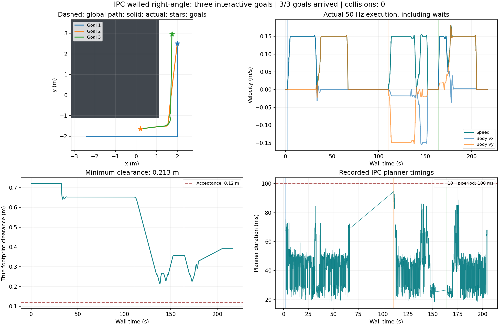
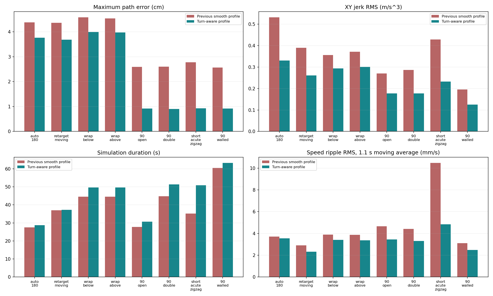

# FW-mini NeuPAN C++ / ROS1 全向导航与仿真验证

面向 Ubuntu 20.04 / ROS Noetic 的 NeuPAN C++ 部署项目。当前主线已移植 Python NeuPAN 的 **omni** 模型，支持固定车身朝向下的二维平移；配置仍可选择 diff 进行回归对照。DUNE 推理使用 Eigen，NRMP 使用 OSQP，部署规划器不依赖 PyTorch、LibTorch 或 cvxpy。

**2026-10-27：急弯预减速、跨地图测试和工控机复测已通过。** 当前推荐参数为 [`neupan_cpp_ros1/config/fw_mini_omni.yaml`](neupan_cpp_ros1/config/fw_mini_omni.yaml)。原 diff 实车执行路线已归档，当前硬件桥接尚未完成 omni 档位 7 转换。

## 工控机验证结果

| 项目 | 本批结果 |
| --- | --- |
| 绕杆、硬直角、连续急弯等专项场景 | **8/8 到达** |
| 14 张随机地图 | **11 张到达，3 张膨胀网格无路** |
| 有全局可行路径的核心闭环 | **19/19 到达，零碰撞、零求解失败** |
| 工控机 ROS1/RViz 连续目标 | **12/12 到达**：原走廊 6 个、绕杆 2 个、直角交互 3 个、自动直角 1 个 |
| 核心测试最小真实车体净距 | **17.90 cm** |
| 工控机正常变化率上限实测 | **0.20 m/s²、0.80 rad/s** |
| 工控机最大实际 XY 加速度 | **约 0.246 m/s²** |
| 工控机自动硬直角外侧过冲 | **约 0.87 cm** |

复核了 46,006 条 CSV 记录，保存的参数和 DUNE 权重散列全部对应当前版本。无路场景不计作到达；全部 22 场景到达率为 19/22，存在全局可行路径的闭环到达率为 19/19。三张无路图和完整原始记录均保留。最长急弯低速约 1.56 s；实测求解最大约 97.3 ms，接近 10 Hz 周期预算。

- [工控机复核报告、会话指标与输入散列](neupan_cpp_ros1/IPC_OMNI_RESULTS_20261027_CN.md)
- [急弯修正、统一参数、全部地图与复测方法](neupan_cpp_ros1/TURN_AND_RANDOM_VALIDATION_CN.md)
- [ROS1 包完整使用说明](neupan_cpp_ros1/README.md)

### 工控机原走廊：六次连续选点


### 工控机绕同一障碍物到另一侧


### 工控机带墙硬直角及连续选点



### 工控机随机地图：同一套参数


### 急弯参数修改前后对照

下图使用上一轮开发机同场景对照；上面四图来自本批工控机结果。预减速降低过冲和速度波纹，但急折返用时会增加。



## 当前实现

```text
RViz 目标 / 外部路径
    → 全局 A*：固定朝向车体膨胀、净距代价、路径平滑
    → C++ NeuPAN：弧长参考与急弯预减速 → PAN（DUNE + NRMP/OSQP）
    → 世界坐标 [vx, vy] → ROS1 车体坐标 Twist.linear.x / linear.y
    → 虚拟底盘、扫描、TF 和实际执行速度反馈
```

omni 内部控制量为有符号速度和世界行进角 `[v, phi]`，状态为 `[x,y,yaw]`，车身 yaw 保持当前值；`angular.z=0`。它不是可同时自主平移、旋转的三自由度轮级模型。全局 A* 和虚拟世界由 Python 实现，局部规划计算为 C++。

急弯采用 0.16 m 转角窗口、0.4 rad/s 参考转角速率和 0.10 m/s² 参考速度包络，在入弯前减速；实际硬限制仍是 `max_speed=[0.18,2*pi]` 和 `max_acce=[0.2,0.8]`。到达门限 0.10 m，车体 0.495×0.360 m。图中的净距按真实矩形碰撞几何计算。

## 源码入口

| 路径 | 用途 |
| --- | --- |
| `neupan_cpp_ros1/core/` | 当前实际链接的 C++ 核心，支持 omni / diff |
| `neupan_cpp_ros1/src/neupan_node.cpp` | ROS1 节点、坐标转换、执行反馈和停车保护 |
| `neupan_cpp_ros1/config/` | 当前及归档参数；`stress/` 为 22 个测试场景 |
| `neupan_cpp_ros1/scripts/rviz_sim.py` | A*、扫描、TF、理想虚拟底盘和交互日志 |
| `neupan_cpp_ros1/test/` | Python 数值参考、核心/ROS1 闭环、随机地图及结果 |
| `neupan_cpp_ros1/tools/` | 构建、复测、绘图、结果审计和打包工具 |
| `libneupan/`、根目录旧工具和历史报告 | 保留的 diff 基线与早期复现材料，当前包不链接外层库 |

## 编译与启动

需要 ROS Noetic、C++17、Eigen ≥3.3、yaml-cpp、OSQP 1.x、OsqpEigen 0.11.x；测试需要 GTest，绘图和审计需要 numpy、matplotlib、PyYAML。已有依赖的工控机可在仓库根目录执行：

```bash
cd neupan_cpp_ros1
NEUPAN_OMNI_BUILD_ROOT="$HOME/neupan_omni_turns_build" \
NEUPAN_OMNI_WS="$HOME/neupan_omni_turns_ws" \
  bash tools/build_ipc.sh all
source ~/neupan_omni_turns_build/activate.bash
```

脚本优先复用 `~/.local/neupan-noetic` 或 `/usr/local` 中的 OSQP/OsqpEigen；也可设置 `NEUPAN_INSTALL_PREFIX`。Git 源码不自带第三方依赖源码；全新机器可使用离线源码包，或设置 `NEUPAN_DEPS_SOURCE_ROOT` 指向包含 osqp、osqp-eigen、qdldl 的目录。源码编译 OSQP 需要 CMake 3.18+ 的 3.x，原系统 CMake 可保留，另用 `NEUPAN_CMAKE` 指定。

启动当前 omni RViz 仿真：

```bash
roslaunch neupan_cpp_ros1 sim_complete.launch \
  config_file:="$(rospack find neupan_cpp_ros1)/config/fw_mini_omni.yaml" \
  output:="$HOME/neupan_sim_results/omni_rviz"
```

RViz 用 **2D Nav Goal** 选终点。加入 `sim_env_config:=stress/bar_auto_180_scenario.yaml auto_goal:=true` 可复现同障碍物 U 形绕行；换成 `stress/hard_90_walled_scenario.yaml` 为带墙硬直角。`sim_complete.launch` 为兼容旧回归仍默认 diff，使用 omni 时必须显式传入上面的 YAML。

重跑完整核心场景：

```bash
bash tools/validate_ipc.sh stress "$HOME/neupan_sim_results/omni_stress"
```

启动独立 omni 规划接口可用 `roslaunch neupan_cpp_ros1 omni.launch`。所有交互仿真话题在 `/neupan_sim/`，无需底盘、CAN、雷达或 FAST-LIO2。

## 归档与实机边界

- [diff 历史 README](README_DIFF_ARCHIVE_CN.md)、[归档说明](DIFF_ARCHIVE_CN.md)。归档分支 `archive/diff-ros1-20261026`、标签 `diff-ros1-20261026` 保留。
- [上一轮走廊平滑记录](neupan_cpp_ros1/SMOOTH_CORRIDOR_CN.md)、[初始 omni 移植验证](neupan_cpp_ros1/OMNI_VALIDATION_CN.md)。当前统一参数以前一轮文件 `fw_mini_omni_corridor_20261027.yaml` 为对照。
- 厂商确认本车不能按原设想锁止后轮使用 diff，因此当前主线采用 omni。现有 `fw_mini_bridge.py` 仍是 diff 接口并拒绝 omni，档位 7 协议换算和实体轮角响应尚未验收，不能把仿真通过视为实车闭环通过。

算法来源：[hanruihua/NeuPAN](https://github.com/hanruihua/NeuPAN)、C++ 参考实现 [zhangkaiyuan007/neupan_cpp](https://github.com/zhangkaiyuan007/neupan_cpp)。本项目沿用 [GPLv3 许可证](LICENSE)，原版权声明保留。
