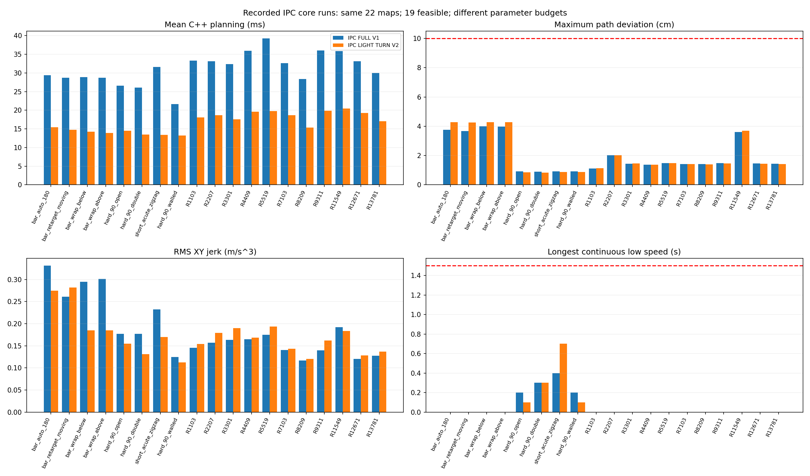
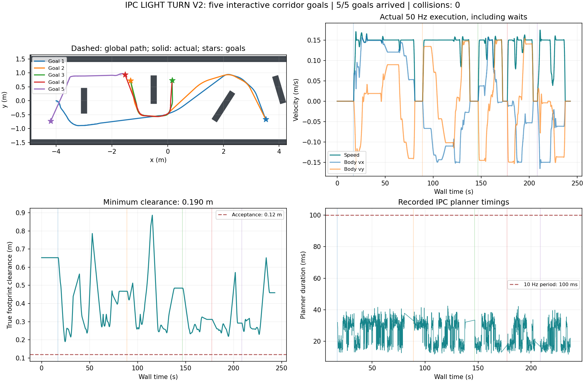
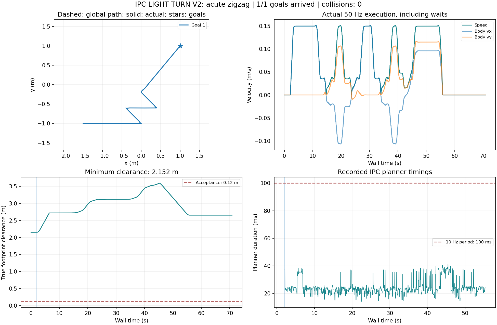
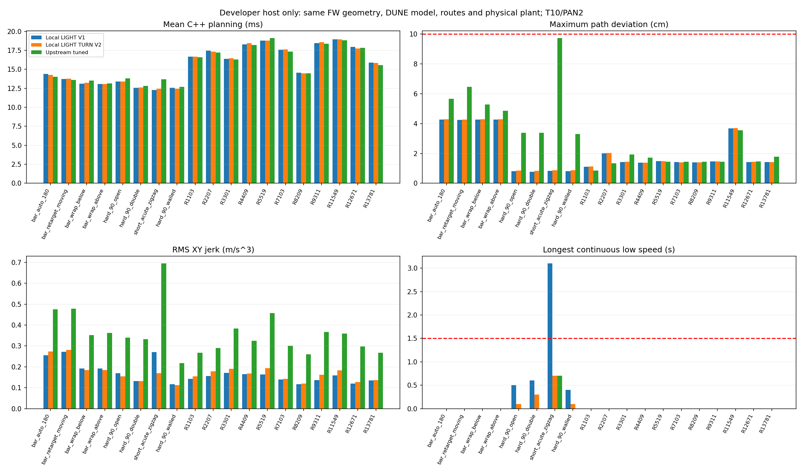

# 工控机 omni 历史与上游调参版对照（2026-10-28）

**本次发布默认参数为 `FW-OMNI-LIGHT-TURN-V2`。** 最新工控机 22 场景中，19 个有路场景全部到达并通过连续低速≤1.5 s 验收，三张全局无路图保留为拒绝；RViz 五次走廊选点及一次连续急弯均到达，零碰撞。核心最长低速 0.7 s，真实 ROS1/RViz 记录最长低速约 1.28 s。

复核用户提供的 `~/neupan_sim_results`，可获得的全部 omni 工控机输入为两组核心测试及六组 ROS1/RViz 会话：历史 FULL V1 四会话、最新 V2 两会话。共独立核查 72,770 条 IPC CSV 记录。早期 LEGACY、旧 CORRIDOR 和 LIGHT V1 未在该目录发现工控机原始记录；它们的开发机结果不冒充工控机数据。

## 工控机核心：历史完整配置与本次 V2

| 指标 | FULL V1，历史工控机 | LIGHT TURN V2，本次工控机 |
|---|---:|---:|
| 预测步数 / PAN上限 / NRMP点数 | 15 / 4 / 12 | 10 / 2 / 10 |
| 到达 / 有路场景 | 19/19 | 19/19 |
| 严格通过，含低速≤1.5 s | 19/19 | 19/19 |
| 平均规划耗时 ms | 31.64 | 17.04 |
| 规划 P95 / 最大 ms | 51.19 / 75.32 | 23.69 / 28.37 |
| 最大路径偏差的场景均值 cm | 1.966 | 2.043 |
| RMS路径偏差的场景均值 cm | 0.393 | 0.416 |
| jerk RMS场景均值 m/s³ | 0.18633 | 0.17115 |
| 最长连续低速 s | 0.4 | 0.7 |
| 最小真实车身净距 cm | 17.90 | 17.89 |
| 仿真行驶总时间 s | 1108.0 | 1111.0 |
| 碰撞 / 优化失败 | 0 / 0 | 0 / 0 |

本次核心平均规划耗时降低 **46.1%**，平均最大路径偏差增加 **3.9%**（绝对增加约 0.077 cm），平均 jerk 降低 **8.2%**。低速从历史 FULL 的 0.4 s 变为 0.7 s，仍满足新目标。相对原小计算 LIGHT V1，V2 的开发机急弯低速由 3.1 s 降至 0.7 s。不能把这两种基线混为一谈。

两次核心测试使用相同的 22 张固定地图、起终点与全局规划器，单次/配置/场景；工控机运行时间和负载不同，没有重复运行置信区间。计时合并 solved 且非 stop 的实际 C++ 规划周期，排除到达和制动空行；误差与 jerk 为场景等权均值。

三张拒绝地图为random_6619、random_10427、random_14891。再次独立洪泛检查确认，在同一保守车体膨胀网格中起终点不连通；这不等于对任意连续路径的物理不可行性证明。保存的两组共44份地图输入均与固定场景一致。

新版19个有路场景与开发机V2记录的步数全部对应，逐点XY最大差约1.27×10⁻⁵ m，未发现导入工控机后明显轨迹偏离。最新ROS运行记录中的配置/模型散列与冻结V2和FW-mini权重一致。



## 所有可获得的 omni 工控机 ROS1/RViz 会话

| 参数 / 会话 | 到达 | 平均 / P95 / 最大规划 ms | 最长连续低速 s | 最小净距 cm | 最大到达误差 cm |
|---|---:|---:|---:|---:|---:|
| V2 走廊选点 | 5/5 | 24.80 / 35.81 / 42.41 | 0.00 | 18.99 | 1.08 |
| V2 连续急弯 | 1/1 | 24.38 / 37.28 / 41.39 | 1.28 | 215.25 | 0.54 |
| FULL 自动带墙直角 | 1/1 | 36.92 / 58.93 / 66.14 | 0.64 | 64.38 | 0.05 |
| FULL 原走廊六目标 | 6/6 | 46.45 / 71.58 / 97.31 | 0.00 | 19.34 | 2.70 |
| FULL 带墙直角三目标 | 3/3 | 41.75 / 68.08 / 94.56 | 1.56 | 21.31 | 1.29 |
| FULL 同障碍物两目标 | 2/2 | 45.85 / 73.30 / 95.56 | 0.00 | 23.67 | 1.01 |

所有会话零碰撞。最新 V2 两会话最大规划耗时约 42.41 ms，未出现 >100 ms 的记录；最高正常速度变化率 0.20 m/s²、方向变化率 0.80 rad/s，车身 yaw 无漂移。启动/换目标时等待首条指令的零速保护单列记录，不当成跟踪急停。

走廊交互选点不同（旧六目标、新五目标），因此表中的 46.45→24.80 ms 只是实际会话对比，不能单独用来证明同一路线精度或通过率提高。连续急弯的核心 0.7 s 与 RViz 1.28 s 分属不同积分、调度和采样链路，不能互相覆盖。ROS诊断由世界节点约50 Hz重复采样，耗时按相邻变化的有效 planner_ms 去重；ROS jerk按约50 Hz求导，不与核心100 ms差分的 jerk直接比较。





## 与上游调参版：同一开发机的闭环数据

上游原核心冻结为 [074718d4](https://github.com/zhangkaiyuan007/neupan_cpp/tree/074718d4a75c5ce83a4b436d6136500124f5782f)，使用此前针对 FW-mini 选出的 `UP-FW-OMNI-TUNED-V2`，不是未调参的哨兵配置，也不是隔离参考逻辑移植版。此组为 i7-13620H 开发机记录；**上游调参版没有本批工控机新实测**，不能拿工控机17.04 ms与开发机16.05 ms直接判断谁快。

两组采用相同 FW-mini 0.495×0.360 m矩形、同一 DUNE 权重、同一全局路线/地图、参考速度0.15 m/s、T10/PAN2、DUNE100/NRMP10。实际底盘能力都为 max_speed=[0.18,2π]、max_acce=[0.2,0.8]；上游规划预测较保守，使用 [0.12,0.4]。换目标后从各自实际位置重规划。两组是在同一开发机的相邻批次测试，并非计时交替的新一轮A/B实验。

| 指标 | 本地 LIGHT TURN V2 | 上游原核心调参版 |
|---|---:|---:|
| 到达 / 严格通过 / ≤1.5 s目标 | 19/19 · 19/19 · 19/19 | 19/19 · 19/19 · 19/19 |
| 最大路径偏差均值 cm | 2.043 | 3.180 |
| RMS路径偏差均值 cm | 0.416 | 0.686 |
| 最差路径偏差 cm | 4.289 | 9.731 |
| jerk RMS均值 m/s³ | 0.17115 | 0.35948 |
| 最长连续低速 s | 0.7 | 0.7 |
| 平均规划耗时 ms | 15.93 | 16.05 |
| 行驶总时间 s | 1111.0 | 1064.4 |
| 最小真实车身净距 cm | 17.89 | 18.01 |
| 碰撞 / 优化失败 | 0 / 0 | 0 / 0 |

| 急弯专项 | 本地 V2 | 上游调参版 |
|---|---:|---:|
| 单直角外侧过冲 cm | 0.859 | 3.377 |
| 连续急弯最大路径偏差 cm | 0.868 | 9.731 |
| 连续急弯 jerk RMS | 0.169 | 0.695 |
| 连续急弯行驶时间 s | 51.800 | 40.100 |

本地 V2 的平均最大路径偏差减少约 **35.7%**，平均 jerk 减少约 **52.4%**；代价是总行驶时间比上游长约 **4.4%**。两者约16 ms的平均规划时间相近，本组单次记录不足以证明微小计时差异有统计意义。上游的优势是本组行驶更快，并非在所有指标上被V2替代。

上游到达标志可能早于实际停车，历史附加核验发现最高残余速度约0.0994 m/s，随后按同一底盘模型制动均安全。该附加22目标核验的停稳平均误差约0.491 cm；不能把上游“标志触发时误差”当成停稳精度，也不能拿它与本轮19场景的其他口径混比。本地核心在正常制动停稳后才报告到达。



## 算法哪里不同，为什么适合当前 FW-mini

共同基础仍是 Eigen DUNE前向、OSQP NRMP优化、PAN交替迭代与固定车身朝向的omni [v,phi]模型。双方都支持上一步实际执行反馈，也都处理omni位置代价，不能把这些共同功能写成V2独有。

| 部分 | 本地 ROS1 V2 | 所比较的上游原核心 | 取舍 |
|---|---|---|---|
| 参考轨迹 | 连续弧长采样，曲率窗口0.16 m；0.4 rad/s转角速度包络和0.10 m/s²前后传播，提前入弯减速 | projected_reference投影后，按固定ref_speed×dt推进圆/折线交点 | 本地减少急角过冲，上游本组行驶更快 |
| NRMP代价 | 额外的控制变化二次项，权重[16,0.5]，首步相对实际执行控制 | 没有该控制变化代价项 | 本地减少速度/方向的反复修正，但不是jerk硬约束 |
| 首步约束 | 在有符号速度/方向角空间，分别按实际执行值和实际间隔锚定，再施加输出变化率限制 | 从上一帧世界XY速度构造首步极坐标近似Box；方向半角用asin(Δv/速度)估计 | 两者约束表达不同，不能说上游完全没有首步限制 |
| 标称轨迹和方向周期 | 保留有符号速度参考，执行反馈转回[v,phi]，按2π重定位并重置PAN缓存 | seedOmni将负速等价改为正速；静止或背离路径时按路径方向播种，并使用wrapToPi | 上游也做角度展开；两者参考初始化和跨周期状态处理不同 |
| 正常到达/求解失败 | 正常到达先限制变化率制动，停稳后发arrive；求解失败进入制动 | 路径到达即发arrive并返回零；未解出可返回限幅后的标称控制 | 本地的到达标志更接近停稳，上游要结合执行层检查 |
| 外形和ROS层 | 当前YAML加载矩形，ROS1 Noetic、XY体坐标输出、虚拟底盘反馈 | 支持YAML自定义凸多边形，ROS2接口及作者哨兵实车工程 | 上游的多边形/实车集成有价值；不等于FW-mini已实车验收 |

实现位置：[本地参考轨迹](core/src/initial_path.cpp)、[本地NRMP](core/src/nrmp.cpp)、[本地执行和到达](core/src/neupan_planner.cpp)；上游对照：[initial_path.cpp](https://github.com/zhangkaiyuan007/neupan_cpp/blob/074718d4a75c5ce83a4b436d6136500124f5782f/libneupan/src/initial_path.cpp)、[nrmp.cpp](https://github.com/zhangkaiyuan007/neupan_cpp/blob/074718d4a75c5ce83a4b436d6136500124f5782f/libneupan/src/nrmp.cpp)、[neupan_planner.cpp](https://github.com/zhangkaiyuan007/neupan_cpp/blob/074718d4a75c5ce83a4b436d6136500124f5782f/libneupan/src/neupan_planner.cpp)。

本轮相对已发布的FULL V1没有重写上述算法；主要改的是预测/PAN/障碍约束预算，以及控制变化代价[12,1]→[16,0.5]。算法差别是本地核心与固定提交上游之间已有的差别。`projected_reference`不能在本地YAML中直接当成`arc_length_sampling`使用，前者不被当前本地核心解析。也不能将全部误差收益归因于某个单独改动：此处尚未做完整消融。

## 默认参数、复现和证据

当前默认文件：[config/fw_mini_omni.yaml](config/fw_mini_omni.yaml)；冻结快照：[FW-OMNI-LIGHT-TURN-V2](config/profiles/ros1/fw_mini_omni_light_turn_v2.yaml)。[配置总表](CONFIG_PROFILES_CN.md)保留FULL、LIGHT基准、历史diff、上游调参等全部命名。默认文件和冻结快照不自动同步；仿真保存的planner.yaml才是该次实际参数。

```bash
source ~/neupan_omni_light_turn_build/activate.bash
cd "$(rospack find neupan_cpp_ros1)"
bash tools/validate_light_turn.sh core
roslaunch neupan_cpp_ros1 sim_complete.launch
```

Git源码在工控机更新后需重新编译；构建与导入见 [IPC_LIGHT_TURN_V2_CN.md](IPC_LIGHT_TURN_V2_CN.md)。RViz默认已选择V2，2D Nav Goal设置终点；其目标话题仍为/neupan_sim/goal。实车档位7的CAN桥接、轮角响应、FAST-LIO同机负载和实车循迹不在本批仿真验收范围。

复核与绘图：

```bash
python3 tools/audit_omni_versions.py \
  --input test/results/ipc_light_turn_20261028/raw \
  --developer-data test/results/ipc_light_turn_20261028/developer_comparison \
  --output /tmp/neupan_omni_audit
python3 tools/report_omni_versions.py \
  --results test/results/ipc_light_turn_20261028 \
  --audit /tmp/neupan_omni_audit/audit.json \
  --report /tmp/neupan_omni_comparison.md
```

- [审计结果](test/results/ipc_light_turn_20261028/audit/audit.json)、[输入文件SHA256](test/results/ipc_light_turn_20261028/audit/INPUT_SHA256.json)：配置/模型对应、逐样本净距、路径误差、低速、加速度和耗时核查。
- [原始工控机记录](test/results/ipc_light_turn_20261028/raw/)、[开发机三组原始记录](test/results/ipc_light_turn_20261028/developer_comparison/)：保留失败与无路图；单独标明测试机器。
- [源码差异与散列](test/results/ipc_light_turn_20261028/algorithm_sources.json)、[无路网格检查](test/results/ipc_light_turn_20261028/audit/no_route_proof.json)：可核对实现和输入。
- [此前工控机报告](IPC_OMNI_RESULTS_20261027_CN.md)、[本轮参数筛选报告](LIGHT_TURN_TUNING_CN.md)：保留历史，口径以本次对照说明为准。

记录能确认参数、模型和保存的输入对应关系，不能单凭结果文件证明工控机CPU型号、编译器版本或二进制来源。本次是静态地图的理想运动学仿真、有限回归集，不宣称任意地图或真实执行器都具有同等表现。
