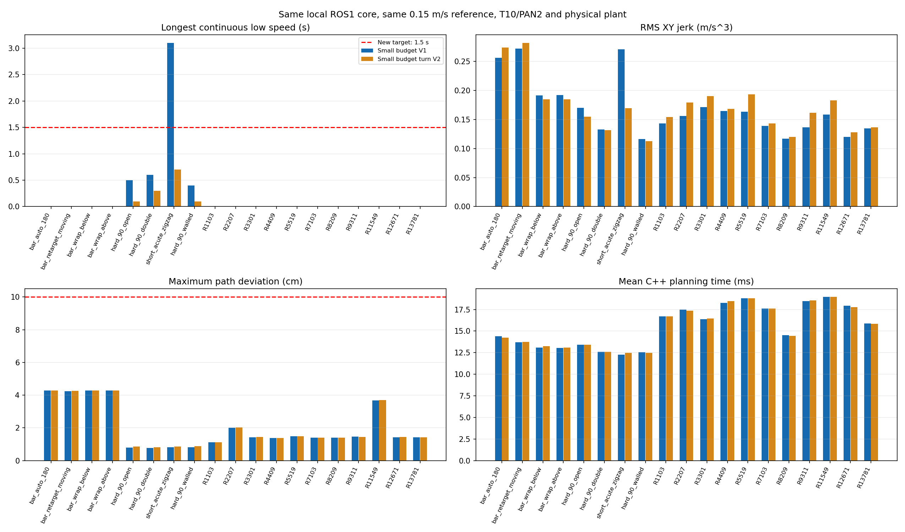
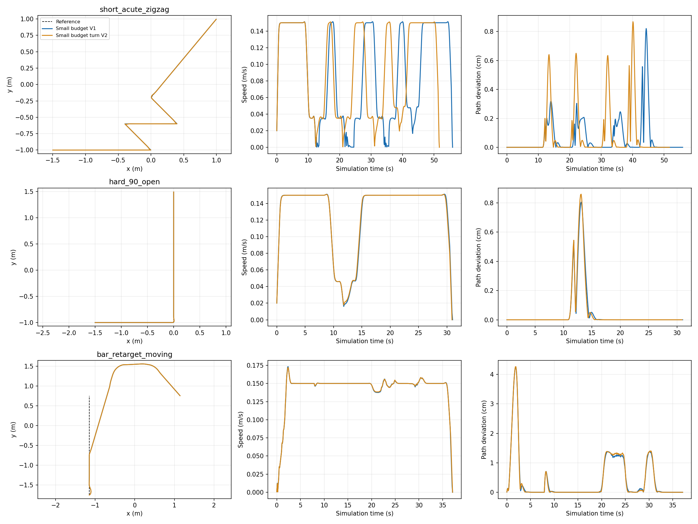

> 2026-10-28后续：工控机复测已通过，默认入口已提升为V2。本文记录此前开发机筛选时的状态，完整对照见 [工控机与上游对照报告](IPC_OMNI_COMPARISON_20261028_CN.md)。

# 本地小计算配置的连续急弯调优（2026-10-28）

目标：原 ROS1 小计算核心保持不变，将最长连续低速压至 1.5 秒以内，连续急弯误差仍在 0.10 m 内，优先保持 jerk；允许适度增加过冲和路径偏差。

27 套参数在连续急弯上筛选，6 套进入直角、换目标绕障、反侧绕障和密集地图复筛。冻结候选 `rv16_rd0p5` 后，用同一套参数跑完整 22 场景及原长廊连续三个目标，没有按验证地图分别调整。

参考速度 0.15 m/s，T10/PAN2，DUNE100/NRMP10，实际底盘/模型/全局规划器/初始路线均保持一致。优先保持 jerk 的工作准则为不超过基准 +5%，这是本次筛选偏好，并非把原验收改宽。实际结果见表。

## 实际参数变化

| 参数 | 小计算 V1 | 急弯 V2 |
|---|---|---|
| `adjust.control_change_weight` | `[12.0, 1.0]` | `[16.0, 0.5]` |

完整参数命名为 **`FW-OMNI-LIGHT-TURN-V2`**，见 [fw_mini_omni_light_turn_v2.yaml](config/profiles/ros1/fw_mini_omni_light_turn_v2.yaml)。基准命名为 `FW-OMNI-LIGHT-V1`。此配置可直接配当前 ROS1 本地核心，不需要上游 projected_reference 或算法移植。

第一项提高对速度跳变的惩罚，第二项放松对行进方向改变的惩罚。这允许急弯中更及时地改变平移方向，减少为等待方向跟上而反复降至接近零速的情况；这是本组对照支持的解释，不是任意地图都能通过的保证。方向变化率硬限值仍为 0.8 rad/s。

## 全套验证

| 指标 | 小计算 V1 | 急弯 V2 |
|---|---:|---:|
| 有路场景到达 | 19/19 | 19/19 |
| 原门限严格通过 | 18/19 | 19/19 |
| 新增低速≤1.5 s 目标通过 | 18/19 | 19/19 |
| 最长连续低速 (s) | 3.1 | 0.7 |
| 最大路径偏差的场景均值 (cm) | 2.027 | 2.043 |
| RMS 路径偏差的场景均值 (cm) | 0.408 | 0.416 |
| jerk RMS 的场景均值 (m/s³) | 0.168800 | 0.171145 |
| 最小车身净距 (m) | 0.1780 | 0.1789 |
| 平均规划耗时 (ms) | 15.906 | 15.930 |
| P95 / 最大规划耗时 (ms) | 21.808 / 40.769 | 21.830 / 48.782 |
| 碰撞 / 优化异常计数 | 0 / 0 | 0 / 0 |

三张共同无路地图保留为全局拒绝，不计作控制到达或通过。低速定义是启动 2 s 后、目标距离>0.2 m、速度<0.02 m/s 的连续时间。最大/RMS 路径误差按车身参考点到当前有效参考折线计算，换目标后切换到实际新路线。场景指标采用等权均值，规划耗时合并 solved 且非 stop 周期，排除到达/制动空行。

## 连续急弯与单直角

| 指标 | 小计算 V1 | 急弯 V2 |
|---|---:|---:|
| 连续急弯低速 (s) | 3.100000 | 0.700000 |
| 连续急弯最大路径偏差 (cm) | 0.820486 | 0.867742 |
| 连续急弯 jerk RMS | 0.271199 | 0.169459 |
| 连续急弯行驶时间 (s) | 56.000000 | 51.800000 |
| 单直角外侧过冲 (cm) | 0.804493 | 0.859116 |

## 原长廊连续目标

| 目标 | 配置 | 到达/原门限/新低速目标 | 最大路径偏差 (cm) | 最长低速 (s) | jerk RMS |
|---|---|---|---:|---:|---:|
| forward | light_v1 | True / True / True | 3.290 | 0.0 | 0.175062 |
| forward | rv16_rd0p5 | True / True / True | 3.313 | 0.0 | 0.189852 |
| reverse | light_v1 | True / True / True | 1.395 | 0.0 | 0.121317 |
| reverse | rv16_rd0p5 | True / True / True | 1.394 | 0.0 | 0.124061 |
| third_goal | light_v1 | True / True / True | 4.176 | 0.0 | 0.289610 |
| third_goal | rv16_rd0p5 | True / True / True | 4.192 | 0.0 | 0.304307 |

连续目标的导数继承上一段实际末帧，不将每段初速度错误归零；此处是原本地核心，两组到达时实际速度均为零。源码/模型/二进制哈希未变，旧默认入口 fw_mini_omni.yaml 仍保留原配置。

全套 19 场景平均 jerk 增加 **1.39%**，满足本次尽量保持的偏好，但不是每个场景都下降。原长廊三目标的平均 jerk 从 0.19533 变为 0.20607，增加 **5.50%**；各目标仍无连续低速且全部通过。所有 19 个有路场景及三个连续目标均满足 ≤1.5 s 目标。

本次耗时是当前开发机 i7-13620H / Release C++ 闭环，同轮串行交替测试；未进行工控机或实机新实测。地图是既有回归集，不宣称新的盲测或全局最优。





命名与参数位置见 [CONFIG_PROFILES_CN.md](CONFIG_PROFILES_CN.md)、[配置总表](config/profiles/README.md) 和 [index.yaml](config/profiles/index.yaml)。旧来源均保留；不同核心下同一 YAML 不合并为同一运行配置。

- 本包内的 [结果目录](test/results/light_turn_20261028/) 保存汇总、两组验证结果、筛选结果、输入哈希和两张对照图。
- [aggregate.json](test/results/light_turn_20261028/aggregate.json) / [per_case_comparison.csv](test/results/light_turn_20261028/per_case_comparison.csv) / [parameter_changes.json](test/results/light_turn_20261028/parameter_changes.json) 可核对表中指标。
- 开发机完整原始数据位于 `/home/xiapilang/work/neupan_local_light_turn_tuning_20261028/`：`stage1/`、`stage2/` 保存筛选 CSV，`validation/`、`corridor/` 保存完整轨迹、路径、日志和四联图；`tune_light.py`、`report_light.py` 记录筛选及审计流程。

## 工控机复测入口

将更新后的本包放进现有工作空间，source 对应 `activate.bash` 后，使用 [参数命名说明](CONFIG_PROFILES_CN.md) 中的 RViz 命令选定 V2。核心全场景可用现有脚本直接选择这份参数：

```bash
cd "$(rospack find neupan_cpp_ros1)"
python3 test/stress_omni_navigation.py \
  --binary "$HOME/neupan_omni_build/core/neupan_ros1_sim_backend" \
  --planner config/profiles/ros1/fw_mini_omni_light_turn_v2.yaml \
  --cases all --output "$HOME/neupan_sim_results/light_turn_v2_core"
```

按实际构建目录替换 `--binary`。现有脚本仍按原 ≤2 s 验收；复核本轮更严格目标时，检查输出 `summary.json` 中有路场景的 `max_stall_seconds` 均不超过 1.5。单独连续急弯可将 `--cases all` 改为 `--cases short_acute_zigzag`。不要只调用未指定 `--planner` 的旧批处理入口来代替这次 V2 复测。
