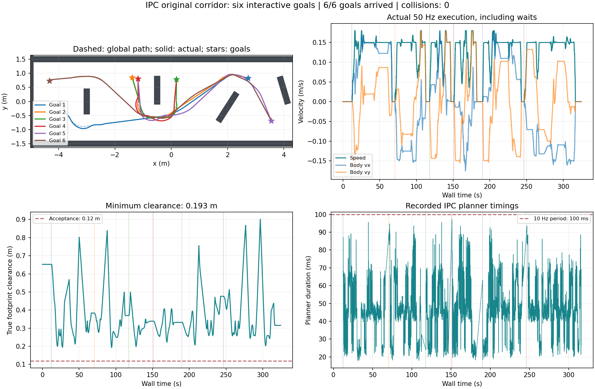
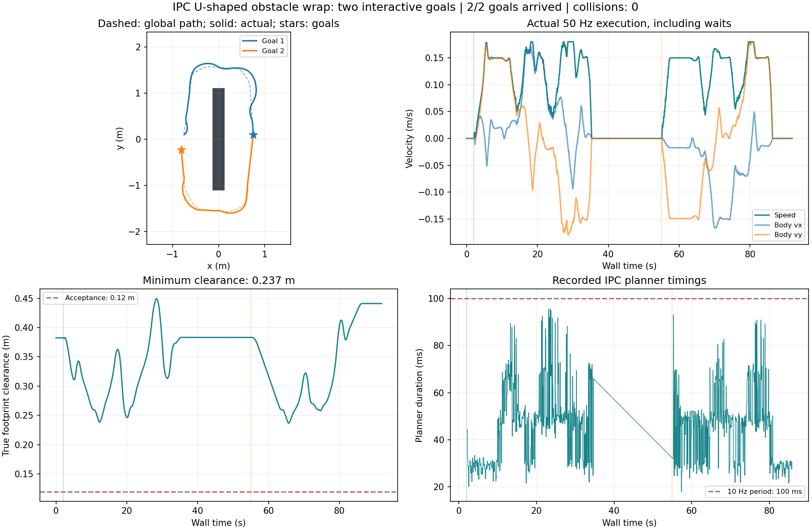
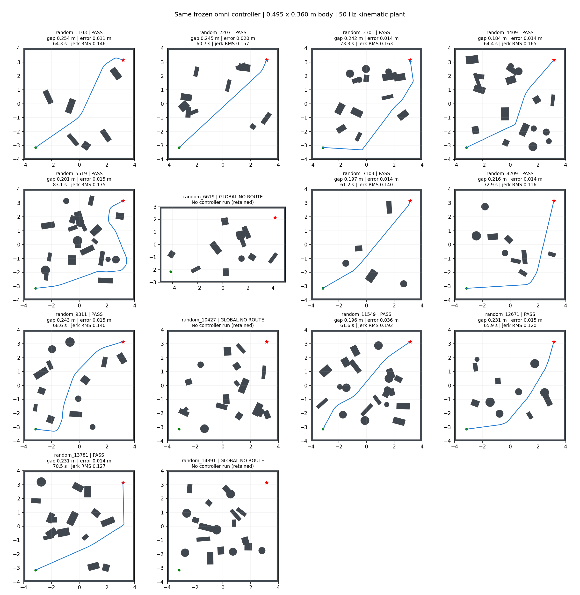

# NeuPAN C++ ROS1：diff / omni 可配置运动学

本包在原有 ROS1 差速版的基础上，移植了 Python NeuPAN 的 `omni` 运动学、轨迹预测和优化目标，并完成 ROS1 速度接口与虚拟底盘的适配。所有新增实现、配置、验证脚本和结果均放在本包内。仓库外层 `libneupan/` 保留差速归档版本；本包编译时链接的是 `core/` 中的 `neupan_ros1_core`，不再链接外层库。

2026-10-27 已加入急弯预减速及跨地图验证，当前 `fw_mini_omni.yaml` 使用统一的新参数。绕同一障碍物、硬直角和随机室内地图的结果、绘图与工控机操作见 [TURN_AND_RANDOM_VALIDATION_CN.md](TURN_AND_RANDOM_VALIDATION_CN.md)。上一轮走廊配置保存在 `config/fw_mini_omni_corridor_20261027.yaml`，报告为 [SMOOTH_CORRIDOR_CN.md](SMOOTH_CORRIDOR_CN.md)；初始移植参数保留在 `fw_mini_omni_legacy.yaml`。


## 工控机复测与图表（2026-10-27）

已核对工控机 46,006 条记录：核心有效路径 19/19 到达，另有 3 张全局无路图；四组 ROS1/RViz 测试共 12/12 目标到达，零碰撞。最大实际 XY 加速度约 0.246 m/s²，速度/方向变化率均在配置范围内。完整指标、短时低速和周期预算说明见 [工控机复核报告](IPC_OMNI_RESULTS_20261027_CN.md)。







## 1. 选择运动模型

运动模型由规划 YAML 中的 `robot.kinematics` 决定，节点自动选择对应逻辑，无需修改源码或重新编译。

| 配置 | 运动模型 | ROS `/neupan_cmd_vel` 输出 |
| --- | --- | --- |
| `config/fw_mini_balanced.yaml` | `diff` | 车体前向 `linear.x`、车体角速度 `angular.z`，`linear.y=0` |
| `config/fw_mini_omni.yaml` | `omni` | 车体坐标 `linear.x`、`linear.y`，`angular.z=0` |

omni 使用原 Python 的二维内部控制量 `[v, phi]`：有符号速度 `v` 与**世界/规划坐标系中的行进方向角** `phi`。状态仍为 `[x,y,yaw]`，预测时 `yaw` 保持当前值。规划器先输出世界坐标 `[vx,vy]`，ROS 节点再按当前 TF 的 yaw 转为车体坐标速度。

例如车体朝世界 +Y（yaw=90°），规划世界 +X 移动时，ROS 输出应为 `linear.x≈0, linear.y<0`，而不是转动车身。终点箭头的 yaw 不会使 omni 机器人原地旋转。

这与 Python 原版一致；不是独立优化 `[vx,vy,w]` 的三自由度模型，也不是双阿克曼转向机构的轮级模型。

### 参数单位

```yaml
robot:
  kinematics: omni
  length: 0.495
  width: 0.360
  wheelbase: 0.0
  max_speed: [0.18, 6.283185307179586]  # |v| m/s、|phi| rad
  periodic_direction: true
  max_acce: [0.2, 0.8]                # |Δv|/dt m/s²、|Δphi|/dt rad/s
```

`wheelbase` 延用原项目的 footprint 原点约定，不能填入实际轴距代替当前值。omni 的第二项不是横向最大速度或车体角加速度。速度向量长度限制为 `max_speed[0]`，方向变化另由第二项限制。改变方向也会造成笛卡尔加速度，因此不能把第一项直接理解为合成 XY 加速度上限；本次配置的实测结果见平滑调参报告。

已有 diff YAML 可继续使用；改成 omni 时应同时检查第二项的单位，推荐以 `fw_mini_omni.yaml` 为模板。未知模型名称会报错，不会退回 diff。

## 2. 编译

依赖：ROS1 Noetic、C++17、Eigen >=3.3、yaml-cpp、OSQP 1.x 和 OsqpEigen 0.11.x。已使用现有 OSQP/OsqpEigen 用户安装前缀验证；运行时不需要 Python NeuPAN、PyTorch 或 cvxpy。

在已完成原 Noetic 安装的工控机上，将本包完整更新到工作空间的对应位置后重新编译，例如：

```bash
source ~/neupan_noetic_build/activate.bash
catkin_make -C ~/neupan_noetic_ws \
  -DCMAKE_BUILD_TYPE=Release \
  -DCATKIN_ENABLE_TESTING=OFF \
  -DNEUPAN_ROS1_CORE_TESTS=OFF \
  -DCMAKE_PREFIX_PATH="$HOME/.local/neupan-noetic;${CMAKE_PREFIX_PATH//:/;}"
source ~/neupan_noetic_build/activate.bash
```

如果使用不同的依赖安装位置，替换上述前缀；系统安装在 `/usr/local` 的 OSQP/OsqpEigen 也可以由 CMake 查找。旧构建缓存中的 `libneupan_DIR` 不再决定本包的核心代码来源。

只编译无 ROS 算法和回归测试：

```bash
cd ~/work/mvp_ws/src/neupan_cpp/neupan_cpp_ros1
cmake -S core -B build/core \
  -DCMAKE_BUILD_TYPE=Release \
  -DCMAKE_PREFIX_PATH="$HOME/.local/neupan-noetic" \
  -DNEUPAN_ROS1_CORE_TESTS=ON
cmake --build build/core -j2
ctest --test-dir build/core --output-on-failure
```

测试还需要 GTest（Noetic 主机可安装 `libgtest-dev`）。保留了 Eigen 3.3 兼容写法，不需要覆盖系统 Eigen。

## 3. ROS1 和 RViz 仿真

仅启动 omni 规划接口：

```bash
roslaunch neupan_cpp_ros1 omni.launch
```

输入和原 ROS1 节点一致：TF、`/scan`、`/initial_path`、`/neupan_goal` 或 `/neupan_waypoints`。`/neupan_goal` 是单数。`omni.launch` 不启动底盘驱动。

启动现有 RViz 地图、A* 路径和虚拟机器人，使用新 omni 配置：

```bash
roslaunch neupan_cpp_ros1 sim_complete.launch \
  config_file:="$(rospack find neupan_cpp_ros1)/config/fw_mini_omni.yaml" \
  output:="$HOME/neupan_sim_results/omni_rviz"
```

在 RViz 使用 **2D Nav Goal** 点选终点；仿真配置已将目标绑定到 `/neupan_sim/goal`。用 2D Pose Estimate 可以改变初始位置和车身朝向。车体可沿不同方向平移，车身方向箭头保持当前朝向。默认地图的全局路径仍由仿真环境的 A* 生成，局部避障和速度由真实 C++ ROS1 节点计算。

切回 diff 只需更换 `config_file`：

```bash
roslaunch neupan_cpp_ros1 sim_complete.launch \
  config_file:="$(rospack find neupan_cpp_ros1)/config/fw_mini_balanced.yaml" \
  output:="$HOME/neupan_sim_results/diff_rviz"
```

虚拟底盘会读取相同的模型配置，omni 反馈包含 `linear.y`，里程计也包含横向速度。omni CSV 使用 `raw_vx/raw_vy/applied_vx/applied_vy` 和 `direction_rate`，避免将横向速度误记为角速度。收到的 Twist 与里程计速度都采用车体坐标。

`sim_complete.launch` 默认配置仍为原 diff 配置，必须显式传入上述 omni YAML 才会使用全向模型。两种模式的消息话题不变。

## 4. 验证

```bash
# 无 ROS 的两种模型闭环（使用本包的可执行文件，不能使用外层旧版 backend）
python3 test/model_closed_loop.py \
  --binary build/core/neupan_ros1_sim_backend \
  --config config/fw_mini_omni.yaml --output /tmp/neupan_omni_results
python3 test/model_closed_loop.py \
  --binary build/core/neupan_ros1_sim_backend \
  --config config/fw_mini_balanced.yaml --output /tmp/neupan_diff_results

# 仿真几何、速度限制和模型接口的 Python 单元测试
python3 -m unittest discover -s test -p 'test_*.py'

# 真实 ROS1 消息、TF、节点闭环和断流停车；自动启动独立 master
python3 test/ros1_model_test.py \
  --node ~/neupan_noetic_ws/devel/lib/neupan_cpp_ros1/neupan_node \
  --with-master --rviz-corridor --output /tmp/neupan_ros1_model_results
```

现有 `scripts/simulation_test.py` 是原 diff 回归工具，保留其 diff 限制。omni 请使用本节的新工具或 RViz 仿真。`test/` 中早期同名 ROS2 参考脚本也不用于本次验证。

`test/data/omni_python_reference.json` 是调用原 Python `robot` 的运动学、代价、约束方法生成的 5 组 QP 数值参考，包含原文件 SHA256。生成脚本为 `test/generate_omni_reference.py`，可在已安装 Python NeuPAN/PyTorch/cvxpy 的训练环境重新生成。普通 C++ 编译和运行只读取固定参考文件，不依赖训练环境。

当前配置的完整验证见 [TURN_AND_RANDOM_VALIDATION_CN.md](TURN_AND_RANDOM_VALIDATION_CN.md)，上一轮走廊结果见 [SMOOTH_CORRIDOR_CN.md](SMOOTH_CORRIDOR_CN.md)，初始移植记录见 [OMNI_VALIDATION_CN.md](OMNI_VALIDATION_CN.md)。`test/results/` 保存摘要、失败/无路地图与闭环轨迹，便于复测。

## 5. 实机接口边界

本次完成模型、C++ 优化器、ROS1 Twist 接口和仿真切换。现有 `fw_mini_bridge.py` 保留原 diff 档案行为，仍拒绝 omni 配置和横向速度；`fw_mini_hardware.launch` 也没有改成档位 7。不能把新 omni YAML 直接传给旧桥接器当作已完成实车适配。

档位 7 的速度/侧偏角协议换算及轮角变化能力需要在后续底盘接口工作中处理。本包输出的标准车体 `[vx,vy]` 已为这一步保留接口；当前移植未发送 CAN、未改变厂商驱动。

## 6. 代码位置与来源

| 路径 | 内容 |
| --- | --- |
| `core/include/neupan`、`core/src` | 包内 DUNE、NRMP、PAN、路径处理和 diff/omni 运动学 |
| `core/tools/sim_backend.cpp` | 本包无 ROS 仿真协议接口 |
| `src/neupan_node.cpp` | ROS1 输入、模型输出映射、反馈与诊断 |
| `scripts/planar_kinematics.py` | 两种模型的理想虚拟底盘 |
| `scripts/rviz_sim.py` | 交互地图、A*、扫描和虚拟闭环 |
| `config/fw_mini_omni.yaml` | FW-mini omni 示例配置 |
| `test/core/test_omni.cpp` | 原 Python 数值对照与全向模型测试 |

Python 参考：[hanruihua/NeuPAN](https://github.com/hanruihua/NeuPAN)，核对版本 `d225c3862654ade30ccd19455997f615a689a670` 的 `neupan/robot/robot.py`、`neupan/blocks/initial_path.py`、`neupan/neupan.py`。C++ 核心源自本仓库已有 [neupan_cpp](https://github.com/zhangkaiyuan007/neupan_cpp) 差速移植代码，继续采用原 GPL-3.0-or-later 许可，原版权头保留。
